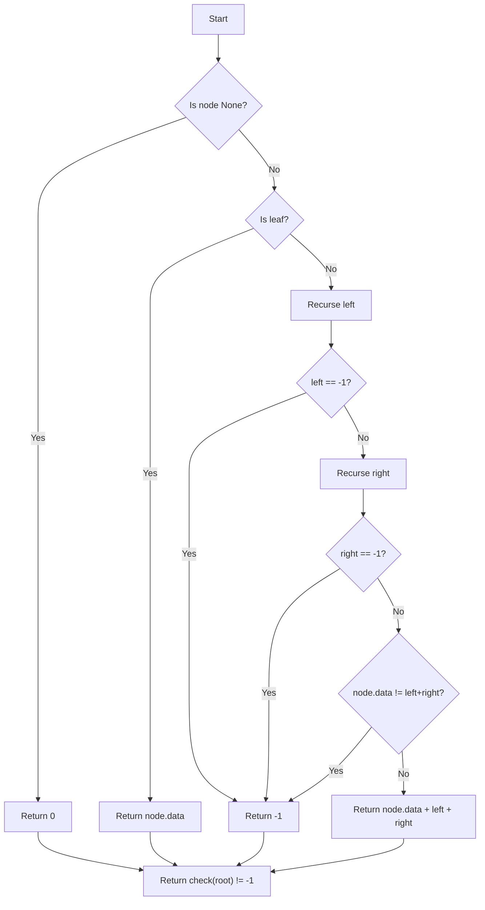

# GFG Sum Tree

Given a binary tree, determine whether it is a Sum Tree. A Sum Tree is a binary tree where the value of each node is equal to the sum of the values of its left and right subtrees. Leaf nodes are trivially Sum Trees.

## Problem Statement

You are given the root of a binary tree. Write a function `isSumTree(root)` that returns `True` if the tree is a Sum Tree and `False` otherwise.

A **binary tree node** is defined as:

```python
class Node:
    def __init__(self, val):
        self.data = val
        self.left = None
        self.right = None
```

## Theory

A Sum Tree satisfies:
- For a leaf node (no children), it is a Sum Tree.
- For an internal node, `node.data == sum(left subtree) + sum(right subtree)`, and both subtrees must also be Sum Trees.
- An empty tree is a Sum Tree.

We can verify this with a single post-order traversal. The helper returns the sum of the subtree if it is a valid Sum Tree, or `-1` if it is not. This avoids recomputing sums.

## Algorithm

1. Define a recursive helper `check(node)`:
   a. If `node` is `None`, return 0.
   b. If `node` is a leaf (both children `None`), return `node.data`.
   c. Recursively compute `left_sum = check(node.left)`. If `-1`, propagate `-1`.
   d. Recursively compute `right_sum = check(node.right)`. If `-1`, propagate `-1`.
   e. If `node.data != left_sum + right_sum`, return `-1`.
   f. Otherwise return `node.data + left_sum + right_sum`.
2. Return `check(root) != -1`.

## Complexity Analysis

| Aspect | Complexity |
|--------|------------|
| Time   | **O(N)** – each node visited once |
| Space  | **O(H)** – recursion stack depth |

## Implementation

```python
'''
# Structure of binary tree node
class Node:
    def __init__(self, val):
        self.data = val
        self.left = None
        self.right = None
'''

class Solution:
    def isSumTree(self, root):
        def check(root):
            if root is None:
                return 0
            if root.left is None and root.right is None:
                return root.data
            left_sum = check(root.left)
            if left_sum == -1:
                return -1
            right_sum = check(root.right)
            if right_sum == -1:
                return -1
            if root.data != left_sum + right_sum:
                return -1
            return root.data + left_sum + right_sum

        return check(root) != -1
```

## Examples

### Example 1
```
Input:
     26
   /    \
  10     3
 /  \     \
4    6     3

Output: True
```

### Example 2
```
Input:
     10
   /    \
  4      6

Output: True
```

### Example 3
```
Input:
     10
   /    \
  4      5

Output: False
```

## Running the Tests

Run tests from the repository root:

```bash
PYTHONPATH=. python BinaryTree/GFG_Sum_Tree/test.py
```

Expected output:

```
=== GFG: Sum Tree ===

PASS: isSumTree([10])
  Expected: True
  Got:      True

PASS: isSumTree([10, 4, 6])
  Expected: True
  Got:      True

PASS: isSumTree([26, 10, 3, 4, 6, None, 3])
  Expected: True
  Got:      True

PASS: isSumTree([10, 4, 5])
  Expected: False
  Got:      False

PASS: isSumTree([1, 2, 3])
  Expected: False
  Got:      False

PASS: isSumTree([])
  Expected: True
  Got:      True

All GFG_Sum_Tree tests passed.
```

## File Structure

```
BinaryTree/
└── GFG_Sum_Tree/
    ├── code.py    # Node and Solution implementation
    ├── test.py    # Unit tests
    └── README.md  # Documentation
```


