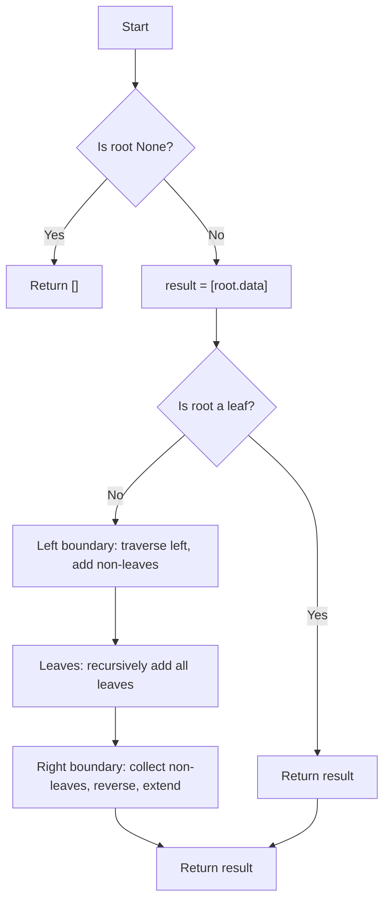

# GFG Tree Boundary Traversal

Given a binary tree, return its boundary traversal (anti-clockwise). The boundary consists of: root, left boundary (excluding leaves), all leaf nodes (left to right), and right boundary (excluding leaves) in reverse order.

## Problem Statement

You are given the root of a binary tree. Write a function `boundaryTraversal(root)` that returns a list of node values in boundary order.

A **binary tree node** is defined as:

```python
class Node:
    def __init__(self, val):
        self.data = val
        self.left = None
        self.right = None
```

## Theory

The boundary traversal has four parts:
1. **Root** (if tree non-empty).
2. **Left boundary**: nodes on the path from root's left child down to the leftmost leaf, excluding leaf nodes.
3. **Leaves**: all leaf nodes from left to right.
4. **Right boundary**: nodes on the path from root's right child down to the rightmost leaf, excluding leaf nodes, added in reverse.

We avoid duplicates by skipping leaf nodes in the left/right boundary steps (they are captured in the leaves step).

## Algorithm

1. If `root` is `None`, return `[]`.
2. Append `root.data` to `result`.
3. If root is a leaf, return `result`.
4. **Left boundary**: traverse from `root.left`, appending non-leaf nodes, preferring left child then right.
5. **Leaves**: recursively collect all leaf nodes (inorder) into `result`.
6. **Right boundary**: traverse from `root.right`, collecting non-leaf nodes into a list, then extend `result` with reversed list.
7. Return `result`.

## Complexity Analysis

| Aspect | Complexity |
|--------|------------|
| Time   | **O(N)** – each node visited a constant number of times |
| Space  | **O(H)** – recursion stack for leaves + boundary lists |

## Implementation

```python
# Definition for Node
class Node:
    def __init__(self, val):
        self.data = val
        self.left = None
        self.right = None

class Solution:
    def boundaryTraversal(self, root):
        if not root:
            return []

        result = []

        def isLeaf(node):
            return not node.left and not node.right

        # Step 1: Add root
        result.append(root.data)

        if isLeaf(root):
            return result

        # Step 2: Add left boundary
        curr = root.left

        while curr:
            if not isLeaf(curr):
                result.append(curr.data)

            if curr.left:
                curr = curr.left
            else:
                curr = curr.right

        # Step 3: Add all leaf nodes
        def addLeaves(node):
            if not node:
                return

            if isLeaf(node):
                result.append(node.data)
                return

            addLeaves(node.left)
            addLeaves(node.right)

        addLeaves(root)

        # Step 4: Add right boundary in reverse
        curr = root.right
        right_boundary = []

        while curr:
            if not isLeaf(curr):
                right_boundary.append(curr.data)

            if curr.right:
                curr = curr.right
            else:
                curr = curr.left

        result.extend(reversed(right_boundary))

        return result
```

## Examples

### Example 1
```
Input:
            1
          /   \
         2     3
        / \   / \
       4   5 6   7
      / \       / \
     8   9     10  11
    / \         \
   12 13        14
  /
 15

Boundary: [1, 2, 4, 8, 12, 15, 13, 9, 10, 11, 14, 7, 3]
```

## Running the Tests

Run tests from the repository root:

```bash
PYTHONPATH=. python BinaryTree/GFG_Tree_Boundary_Traversal/test.py
```

Expected output:

```
=== GFG: Tree Boundary Traversal ===

PASS: boundaryTraversal([1, 2, 3, 4, 5, 6, 7, 8, 9, 10, 11, 12, 13, 14, 15])
  Expected: [1, 2, 4, 8, 9, 10, 11, 12, 13, 14, 15, 7, 3]
  Got:      [1, 2, 4, 8, 9, 10, 11, 12, 13, 14, 15, 7, 3]

PASS: boundaryTraversal([1, 2, 3])
  Expected: [1, 2, 3]
  Got:      [1, 2, 3]

PASS: boundaryTraversal([1])
  Expected: [1]
  Got:      [1]

PASS: boundaryTraversal([])
  Expected: []
  Got:      []

All GFG_Tree_Boundary_Traversal tests passed.
```

## File Structure

```
BinaryTree/
└── GFG_Tree_Boundary_Traversal/
    ├── code.py    # Node and Solution implementation
    ├── test.py    # Unit tests
    └── README.md  # Documentation
```


