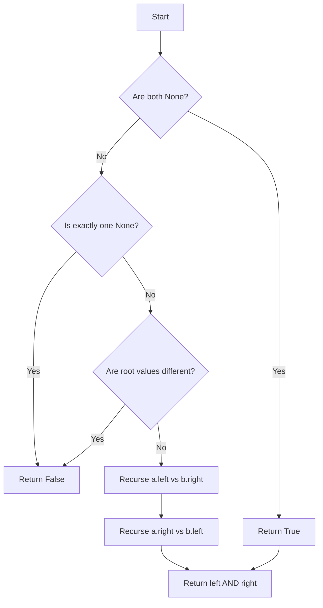

# GFG Two Mirror Trees

Given two binary trees, determine whether one is the mirror of the other. Two trees are mirror images if their structures are mirror-symmetric and corresponding nodes have equal values.

## Problem Statement

You are given the roots of two binary trees `a` and `b`. Write a function `areMirror(a, b)` that returns `True` if `b` is the mirror image of `a`, and `False` otherwise.

A **binary tree node** is defined as:

```python
class Node:
    def __init__(self, val):
        self.data = val
        self.left = None
        self.right = None
```

## Theory

Two trees are mirror images if:
1. Both are empty, OR
2. Both are non-empty, their root values are equal, and the left subtree of `a` is the mirror of the right subtree of `b`, and the right subtree of `a` is the mirror of the left subtree of `b`.

This is a recursive comparison where we cross the left/right children.

## Algorithm

1. If both `a` and `b` are `None`, return `True`.
2. If exactly one is `None`, return `False`.
3. If `a.data != b.data`, return `False`.
4. Recursively check `areMirror(a.left, b.right)` and `areMirror(a.right, b.left)`.
5. Return the logical AND of both recursive results.

## Complexity Analysis

| Aspect | Complexity |
|--------|------------|
| Time   | **O(N)** – where N is the number of nodes in the smaller tree |
| Space  | **O(H)** – recursion stack depth equal to tree height |

## Implementation

```python
'''
# Structure of binary tree node
class Node:
    def __init__(self, val):
        self.data = val
        self.left = None
        self.right = None
'''

class Solution:
    def areMirror(self, a, b):
        if a is None and b is None:
            return True
        if a is None or b is None:
            return False
        if a.data != b.data:
            return False

        return (self.areMirror(a.left, b.right) and
                self.areMirror(a.right, b.left))
```

## Examples

### Example 1
```
Tree a:       Tree b:
     1             1
   /   \         /   \
  2     3       3     2

Output: True
```

### Example 2
```
Tree a:       Tree b:
     1             1
   /   \         /   \
  2     3       2     3

Output: False
```

### Example 3
```
Tree a:       Tree b:
Empty         Empty

Output: True
```

## Running the Tests

Run tests from the repository root:

```bash
PYTHONPATH=. python BinaryTree/GFG_Two_Mirror_Trees/test.py
```

Expected output:

```
=== GFG: Two Mirror Trees ===

PASS: areMirror([1, 2, 3], [1, 3, 2])
  Expected: True
  Got:      True

PASS: areMirror([1, 2, 3], [1, 2, 3])
  Expected: False
  Got:      False

PASS: areMirror([], [])
  Expected: True
  Got:      True

PASS: areMirror([1], [1])
  Expected: True
  Got:      True

PASS: areMirror([1, 2, 3], [1, 2])
  Expected: False
  Got:      False

All GFG_Two_Mirror_Trees tests passed.
```

## File Structure

```
BinaryTree/
└── GFG_Two_Mirror_Trees/
    ├── code.py    # Node and Solution implementation
    ├── test.py    # Unit tests
    └── README.md  # Documentation
```


