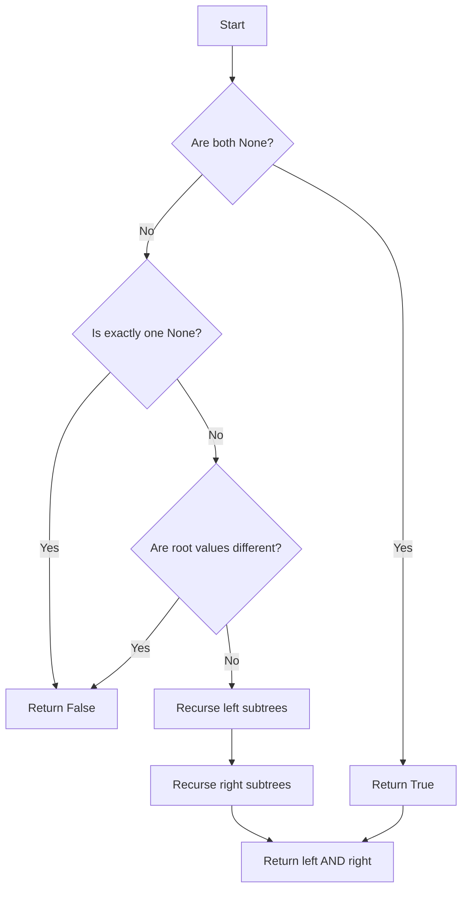

# LC 100 Same Tree

Given two binary trees, determine whether they are the same tree. Two binary trees are considered the same if they are structurally identical and the nodes have the same values.

## Problem Statement

You are given the roots of two binary trees `p` and `q`. Write a function `isSameTree(p, q)` that returns `True` if the two trees are the same and `False` otherwise.

A **binary tree node** is defined as:

```python
class TreeNode:
    def __init__(self, val=0, left=None, right=None):
        self.val = val
        self.left = left
        self.right = right
```

## Theory

Two trees are the same if:
1. Both are empty, OR
2. Both are non-empty, their root values are equal, and their left and right subtrees are the same.

This is a classic recursive problem: compare roots, then recurse on left and right children.

## Algorithm

1. If both `p` and `q` are `None`, return `True`.
2. If exactly one is `None`, return `False`.
3. If `p.val != q.val`, return `False`.
4. Recursively check `isSameTree(p.left, q.left)` and `isSameTree(p.right, q.right)`.
5. Return the logical AND of both recursive results.

## Complexity Analysis

| Aspect | Complexity |
|--------|------------|
| Time   | **O(N)** – where N is the number of nodes in the smaller tree |
| Space  | **O(H)** – recursion stack depth equal to tree height |

## Implementation

```python
# Definition for a binary tree node.
class TreeNode:
    def __init__(self, val=0, left=None, right=None):
        self.val = val
        self.left = left
        self.right = right

class Solution:
    def isSameTree(self, p: TreeNode | None, q: TreeNode | None) -> bool:
        if p is None and q is None:
            return True
        if p is None or q is None:
            return False
        if p.val != q.val:
            return False
        return (self.isSameTree(p.left, q.left) and
                self.isSameTree(p.right, q.right))
```

## Examples

### Example 1
```
Tree p:       Tree q:
     1             1
   /   \         /   \
  2     3       2     3

Output: True
```

### Example 2
```
Tree p:       Tree q:
     1             1
   /               \
  2                 2

Output: False
```

### Example 3
```
Tree p:       Tree q:
     1             1
   /   \         /   \
  2     1       1     2

Output: False
```

## Running the Tests

Run tests from the repository root:

```bash
PYTHONPATH=. python BinaryTree/LC_100/test.py
```

Expected output:

```
=== LC 100: Same Tree ===

PASS: isSameTree([1, 2, 3], [1, 2, 3])
  Expected: True
  Got:      True

PASS: isSameTree([1, 2], [1, None, 2])
  Expected: False
  Got:      False

PASS: isSameTree([1, 2, 1], [1, 1, 2])
  Expected: False
  Got:      False

PASS: isSameTree([], [])
  Expected: True
  Got:      True

PASS: isSameTree([1], [1])
  Expected: True
  Got:      True

All LC_100 tests passed.
```

## File Structure

```
BinaryTree/
└── LC_100/
    ├── code.py    # TreeNode and Solution implementation
    ├── test.py    # Unit tests
    └── README.md  # Documentation
```


