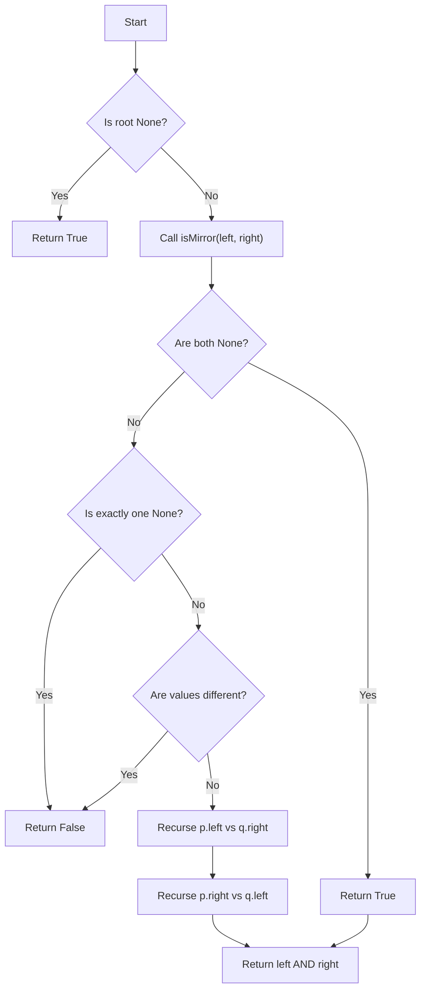

# LC 101 Symmetric Tree

Given a binary tree, check whether it is a mirror of itself (i.e., symmetric around its center).

## Problem Statement

You are given the root of a binary tree. Write a function `isSymmetric(root)` that returns `True` if the tree is symmetric and `False` otherwise.

A **binary tree node** is defined as:

```python
class TreeNode:
    def __init__(self, val=0, left=None, right=None):
        self.val = val
        self.left = left
        self.right = right
```

## Theory

A tree is symmetric if its left subtree is a mirror reflection of its right subtree. We can define a helper `isMirror(p, q)` that checks whether two trees are mirror images of each other:
1. Both are empty, OR
2. Both are non-empty, their root values are equal, and `p.left` is mirror of `q.right` and `p.right` is mirror of `q.left`.

## Algorithm

1. If `root` is `None`, return `True`.
2. Call `isMirror(root.left, root.right)`.

## Complexity Analysis

| Aspect | Complexity |
|--------|------------|
| Time   | **O(N)** – each node visited once |
| Space  | **O(H)** – recursion stack depth |

## Implementation

```python
# Definition for a binary tree node.
class TreeNode:
    def __init__(self, val=0, left=None, right=None):
        self.val = val
        self.left = left
        self.right = right

class Solution:
    def isSymmetric(self, root: TreeNode | None) -> bool:
        def isMirror(p, q):
            if p is None and q is None:
                return True
            if p is None or q is None:
                return False
            if p.val != q.val:
                return False
            return (
                (isMirror(p.left, q.right) and (isMirror(p.right, q.left)))
            )
        if root is None:
            return True
        return isMirror(root.left, root.right)
```

## Examples

### Example 1
```
Input:
     1
   /   \
  2     2
 / \   / \
3   4 4   3

Output: True
```

### Example 2
```
Input:
     1
   /   \
  2     2
   \     \
   3      3

Output: False
```

## Running the Tests

Run tests from the repository root:

```bash
PYTHONPATH=. python BinaryTree/LC_101/test.py
```

Expected output:

```
=== LC 101: Symmetric Tree ===

PASS: isSymmetric([1, 2, 2, 3, 4, 4, 3])
  Expected: True
  Got:      True

PASS: isSymmetric([1, 2, 2, None, 3, None, 3])
  Expected: False
  Got:      False

PASS: isSymmetric([])
  Expected: True
  Got:      True

PASS: isSymmetric([1])
  Expected: True
  Got:      True

PASS: isSymmetric([1, 2, 3])
  Expected: False
  Got:      False

All LC_101 tests passed.
```

## File Structure

```
BinaryTree/
└── LC_101/
    ├── code.py    # TreeNode and Solution implementation
    ├── test.py    # Unit tests
    └── README.md  # Documentation
```


