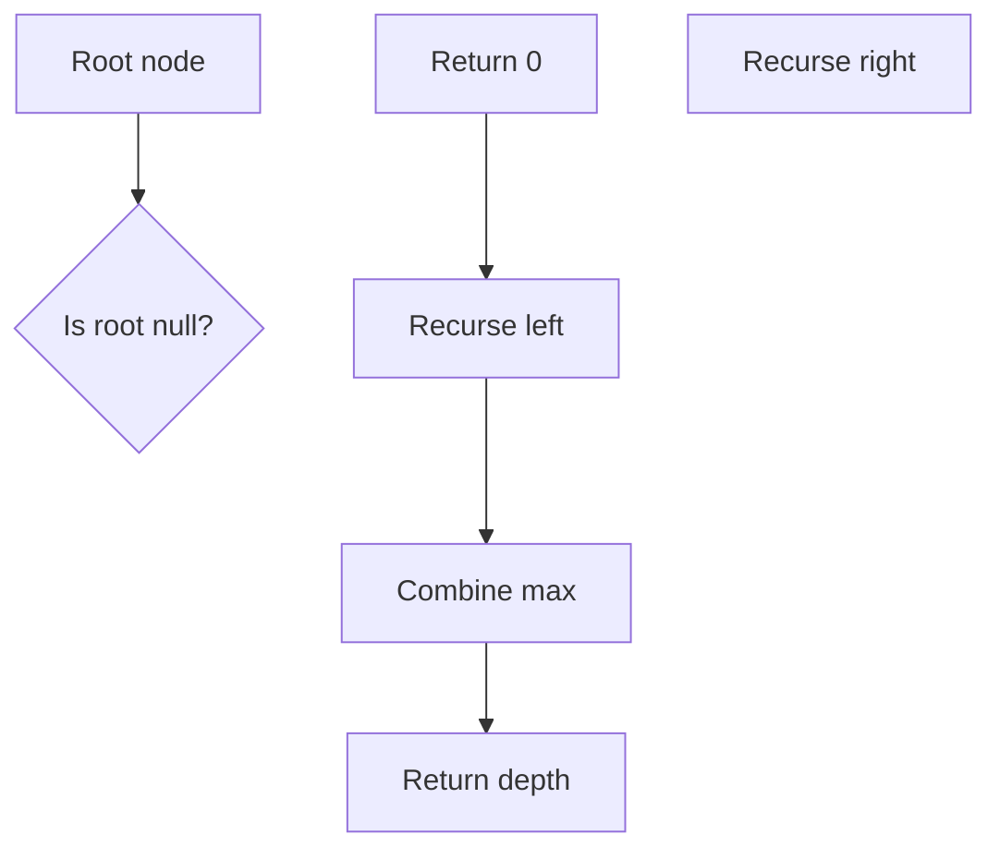

# LC 104 - Maximum Depth of Binary Tree

Given the root of a binary tree, return its maximum depth.

## Problem Statement

The maximum depth of a binary tree is the number of nodes along the longest path from the root node down to the farthest leaf node.

## Examples

### Example 1
```
Input: [3,9,20,null,null,15,7]
Output: 3
Explanation: The tree has three levels:
1. Level 1: node 3
2. Level 2: nodes 9, 20
3. Level 3: nodes 15, 7
```

### Example 2
```
Input: [1,null,2]
Output: 2
Explanation: The tree has two levels:
1. Level 1: node 1
2. Level 2: node 2
```

## Constraints

- The number of nodes in the tree is in the range `[0, 10^4]`.
- `-100 <= Node.val <= 100`

## Algorithm

The solution uses a recursive approach to compute the depth of each subtree and combine the maximum depths of left and right sub‑trees.

## Implementation

```python
class Solution:
    def maxDepth(self, root: TreeNode | None) -> int:
        if root is None:
            return 0
        left = self.maxDepth(root.left)
        right = self.maxDepth(root.right)
        return 1 + max(left, right)
```

## Running the Tests

The `test.py` file tests the solution with three cases:

- A tree with three levels (Example 1).
- A tree with two levels (Example 2).
- An empty tree.

Run tests from the repository root:

```bash
PYTHONPATH=. python BinaryTree/LC_104/test.py
```

Expected output:

```
All LC_104 tests passed.
```

## File Structure

```
BinaryTree/
└── LC_104/
    ├── code.py    # TreeNode and Solution implementation
    ├── test.py    # Unit tests
    └── README.md  # Documentation
```

