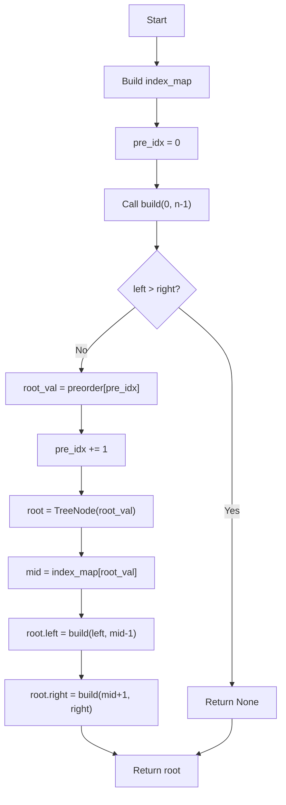

# LC 105 Construct Binary Tree from Preorder and Inorder Traversal

Given preorder and inorder traversals of a binary tree, construct the original binary tree.

## Problem Statement

You are given two integer arrays `preorder` and `inorder` representing the preorder and inorder traversals of a binary tree. Write a function `buildTree(preorder, inorder)` that returns the root of the constructed tree.

A **binary tree node** is defined as:

```python
class TreeNode:
    def __init__(self, val=0, left=None, right=None):
        self.val = val
        self.left = left
        self.right = right
```

## Theory

In preorder traversal, the first element is always the root. We can find this root in the inorder array; elements to its left form the left subtree and elements to its right form the right subtree. We recursively build left and right subtrees.

To make lookup O(1), we build a hash map from value to index in the inorder array. We track the current preorder index using a `nonlocal` variable.

## Algorithm

1. Build `index_map = {val: i for i, val in enumerate(inorder)}`.
2. Initialize `pre_idx = 0`.
3. Define a recursive helper `build(left, right)`:
   a. If `left > right`, return `None`.
   b. `root_val = preorder[pre_idx]`; increment `pre_idx`.
   c. `root = TreeNode(root_val)`.
   d. `mid = index_map[root_val]`.
   e. `root.left = build(left, mid - 1)`.
   f. `root.right = build(mid + 1, right)`.
   g. Return `root`.
4. Return `build(0, len(inorder) - 1)`.

## Complexity Analysis

| Aspect | Complexity |
|--------|------------|
| Time   | **O(N)** – each node created once; hash map gives O(1) lookup |
| Space  | **O(N)** – hash map and recursion stack |

## Implementation

```python
# Definition for a binary tree node.
class TreeNode:
    def __init__(self, val=0, left=None, right=None):
        self.val = val
        self.left = left
        self.right = right

class Solution:
    def buildTree(self, preorder: list[int], inorder: list[int]) -> TreeNode | None:
        index_map = {
            val: i for i, val in enumerate(inorder)
        }
        pre_idx = 0

        def build(left, right):
            nonlocal pre_idx
            if left > right:
                return None
            root_val = preorder[pre_idx]
            pre_idx += 1
            root = TreeNode(root_val)
            mid = index_map[root_val]

            root.left = build(left, mid - 1)
            root.right = build(mid + 1, right)

            return root

        return build(0, len(inorder) - 1)
```

## Examples

### Example 1
```
Preorder: [3, 9, 20, 15, 7]
Inorder:  [9, 3, 15, 20, 7]

Tree:
         3
       /   \
      9     20
           /  \
          15   7
```

### Example 2
```
Preorder: [-1]
Inorder:  [-1]

Tree: single node -1
```

## Running the Tests

Run tests from the repository root:

```bash
PYTHONPATH=. python BinaryTree/LC_105/test.py
```

Expected output:

```
=== LC 105: Construct Binary Tree from Preorder and Inorder Traversal ===

PASS: buildTree(preorder=[3, 9, 20, 15, 7], inorder=[9, 3, 15, 20, 7])
  Preorder: [3, 9, 20, 15, 7] (expected [3, 9, 20, 15, 7])
  Inorder:  [9, 3, 15, 20, 7] (expected [9, 3, 15, 20, 7])

PASS: buildTree(preorder=[-1], inorder=[-1])
  Preorder: [-1] (expected [-1])
  Inorder:  [-1] (expected [-1])

PASS: buildTree(preorder=[], inorder=[])
  Preorder: [] (expected [])
  Inorder:  [] (expected [])

PASS: buildTree(preorder=[1, 2, 3], inorder=[2, 1, 3])
  Preorder: [1, 2, 3] (expected [1, 2, 3])
  Inorder:  [2, 1, 3] (expected [2, 1, 3])

All LC_105 tests passed.
```

## File Structure

```
BinaryTree/
└── LC_105/
    ├── code.py    # TreeNode and Solution implementation
    ├── test.py    # Unit tests
    └── README.md  # Documentation
```


