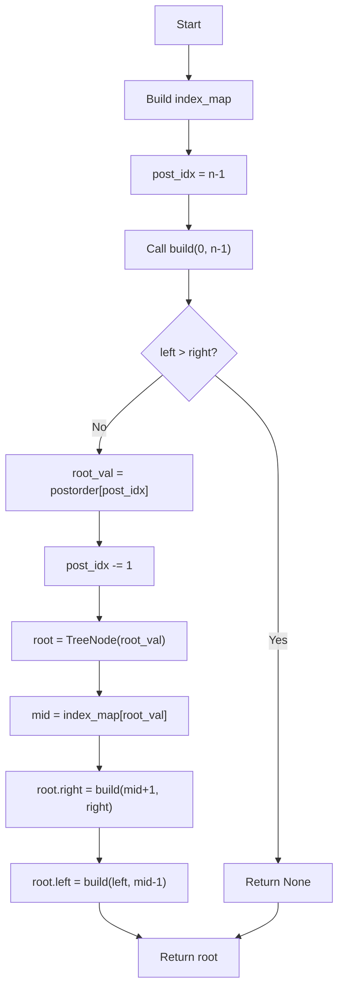

# LC 106 Construct Binary Tree from Inorder and Postorder Traversal

Given inorder and postorder traversals of a binary tree, construct the original binary tree.

## Problem Statement

You are given two integer arrays `inorder` and `postorder` representing the inorder and postorder traversals of a binary tree. Write a function `buildTree(inorder, postorder)` that returns the root of the constructed tree.

A **binary tree node** is defined as:

```python
class TreeNode:
    def __init__(self, val=0, left=None, right=None):
        self.val = val
        self.left = left
        self.right = right
```

## Theory

In postorder traversal, the last element is always the root. We can find this root in the inorder array; elements to its left form the left subtree and elements to its right form the right subtree. We recursively build right and left subtrees (right first, since we iterate postorder backwards).

To make lookup O(1), we build a hash map from value to index in the inorder array. We track the current postorder index using a `nonlocal` variable starting at the last index, decrementing.

## Algorithm

1. Build `index_map = {val: i for i, val in enumerate(inorder)}`.
2. Initialize `post_idx = len(postorder) - 1`.
3. Define a recursive helper `build(left, right)`:
   a. If `left > right`, return `None`.
   b. `root_val = postorder[post_idx]`; decrement `post_idx`.
   c. `root = TreeNode(root_val)`.
   d. `mid = index_map[root_val]`.
   e. `root.right = build(mid + 1, right)` (right first).
   f. `root.left = build(left, mid - 1)`.
   g. Return `root`.
4. Return `build(0, len(inorder) - 1)`.

## Complexity Analysis

| Aspect | Complexity |
|--------|------------|
| Time   | **O(N)** – each node created once; hash map gives O(1) lookup |
| Space  | **O(N)** – hash map and recursion stack |

## Implementation

```python
from typing import Optional, List

# Definition for a binary tree node.
class TreeNode:
    def __init__(self, val=0, left=None, right=None):
        self.val = val
        self.left = left
        self.right = right

class Solution:
    def buildTree(self, inorder: List[int], postorder: List[int]) -> Optional[TreeNode]:
        index_map = {val: i for i, val in enumerate(inorder)}
        post_idx = len(postorder) - 1

        def build(left, right):
            nonlocal post_idx
            if left > right:
                return None
            root_val = postorder[post_idx]
            post_idx -= 1
            root = TreeNode(root_val)
            mid = index_map[root_val]
            root.right = build(mid + 1, right)
            root.left = build(left, mid - 1)
            return root

        return build(0, len(inorder) - 1)
```

## Examples

### Example 1
```
Inorder:   [9, 3, 15, 20, 7]
Postorder: [9, 15, 7, 20, 3]

Tree:
         3
       /   \
      9     20
           /  \
          15   7
```

### Example 2
```
Inorder:   [-1]
Postorder: [-1]

Tree: single node -1
```

## Running the Tests

Run tests from the repository root:

```bash
PYTHONPATH=. python BinaryTree/LC_106/test.py
```

Expected output:

```
=== LC 106: Construct Binary Tree from Inorder and Postorder Traversal ===

PASS: buildTree(inorder=[9, 3, 15, 20, 7], postorder=[9, 15, 7, 20, 3])
  Inorder:   [9, 3, 15, 20, 7] (expected [9, 3, 15, 20, 7])
  Postorder: [9, 15, 7, 20, 3] (expected [9, 15, 7, 20, 3])

PASS: buildTree(inorder=[-1], postorder=[-1])
  Inorder:   [-1] (expected [-1])
  Postorder: [-1] (expected [-1])

PASS: buildTree(inorder=[], postorder=[])
  Inorder:   [] (expected [])
  Postorder: [] (expected [])

PASS: buildTree(inorder=[2, 1, 3], postorder=[2, 3, 1])
  Inorder:   [2, 1, 3] (expected [2, 1, 3])
  Postorder: [2, 3, 1] (expected [2, 3, 1])

All LC_106 tests passed.
```

## File Structure

```
BinaryTree/
└── LC_106/
    ├── code.py    # TreeNode and Solution implementation
    ├── test.py    # Unit tests
    └── README.md  # Documentation
```


