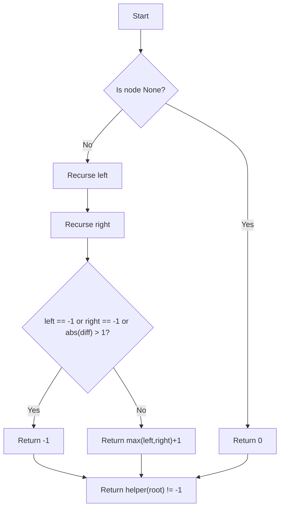

# LC 110 Balanced Binary Tree

Given a binary tree, determine whether it is height-balanced. A binary tree is balanced if, for every node, the height difference between its left and right subtrees is at most 1.

## Problem Statement

You are given the root of a binary tree. Write a function `isBalanced(root)` that returns `True` if the tree is height-balanced and `False` otherwise.

A **binary tree node** is defined as:

```python
class TreeNode:
    def __init__(self, val=0, left=None, right=None):
        self.val = val
        self.left = left
        self.right = right
```

## Theory

A tree is height-balanced if for every node, the absolute difference between the heights of its left and right subtrees is at most 1, and both subtrees are also balanced.

We can compute this efficiently in a single post-order traversal. The helper returns the height of the subtree if it is balanced, or `-1` if it is unbalanced. This avoids recomputing heights multiple times.

## Algorithm

1. Define a recursive helper `helper(node)`:
   a. If `node` is `None`, return 0 (height of empty tree).
   b. Recursively compute `left_node = helper(node.left)`.
   c. Recursively compute `right_node = helper(node.right)`.
   d. If either is `-1` (unbalanced) or `abs(left_node - right_node) > 1`, return `-1`.
   e. Otherwise return `max(left_node, right_node) + 1`.
2. Return `helper(root) != -1`.

## Complexity Analysis

| Aspect | Complexity |
|--------|------------|
| Time   | **O(N)** – each node visited once |
| Space  | **O(H)** – recursion stack depth |

## Implementation

```python
# Definition for a binary tree node.
class TreeNode:
    def __init__(self, val=0, left=None, right=None):
        self.val = val
        self.left = left
        self.right = right

class Solution:
    def isBalanced(self, root: TreeNode | None) -> bool:
        def helper(root):
            if root is None:
                return 0

            left_node = helper(root.left)
            right_node = helper(root.right)

            if left_node == -1 or right_node == -1 or abs(left_node - right_node) > 1:
                return -1

            return max(left_node, right_node) + 1

        return helper(root) != -1
```

## Examples

### Example 1
```
Input:
     3
   /   \
  9     20
       /  \
      15   7

Output: True
```

### Example 2
```
Input:
       1
     /   \
    2     2
   / \
  3   3
 / \
4   4

Output: False
```

## Running the Tests

Run tests from the repository root:

```bash
PYTHONPATH=. python BinaryTree/LC_110/test.py
```

Expected output:

```
=== LC 110: Balanced Binary Tree ===

PASS: isBalanced([3, 9, 20, None, None, 15, 7])
  Expected: True
  Got:      True

PASS: isBalanced([1, 2, 2, 3, 3, None, None, 4, 4])
  Expected: False
  Got:      False

PASS: isBalanced([1])
  Expected: True
  Got:      True

PASS: isBalanced([])
  Expected: True
  Got:      True

PASS: isBalanced([1, 2, 3, 4, 5, 6, 7])
  Expected: True
  Got:      True

All LC_110 tests passed.
```

## File Structure

```
BinaryTree/
└── LC_110/
    ├── code.py    # TreeNode and Solution implementation
    ├── test.py    # Unit tests
    └── README.md  # Documentation
```


