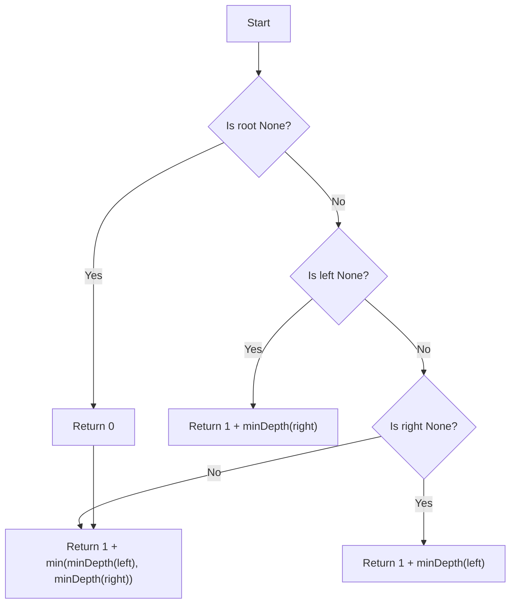

# LC 111 Minimum Depth of Binary Tree

Given a binary tree, find its minimum depth. The minimum depth is the number of nodes along the shortest path from the root node down to the nearest leaf node.

## Problem Statement

You are given the root of a binary tree. Write a function `minDepth(root)` that returns the minimum depth of the tree.

A **binary tree node** is defined as:

```python
class TreeNode:
    def __init__(self, val=0, left=None, right=None):
        self.val = val
        self.left = left
        self.right = right
```

## Theory

The minimum depth is the shortest path from root to a leaf. Note that a node with one child is not a leaf — we must go down to an actual leaf. If a node has only one child, we cannot stop there; we must continue down that child's path.

## Algorithm

1. If `root` is `None`, return 0.
2. If `root.left` is `None`, return `1 + minDepth(root.right)` (only right subtree matters).
3. If `root.right` is `None`, return `1 + minDepth(root.left)` (only left subtree matters).
4. Otherwise, return `1 + min(minDepth(root.left), minDepth(root.right))`.

## Complexity Analysis

| Aspect | Complexity |
|--------|------------|
| Time   | **O(N)** – each node visited once |
| Space  | **O(H)** – recursion stack depth |

## Implementation

```python
# Definition for a binary tree node.
class TreeNode:
    def __init__(self, val=0, left=None, right=None):
        self.val = val
        self.left = left
        self.right = right

class Solution:
    def minDepth(self, root: TreeNode | None) -> int:
        if root is None:
            return 0
        if root.left is None:
            return 1 + self.minDepth(root.right)
        if root.right is None:
            return 1 + self.minDepth(root.left)

        return 1 + min(self.minDepth(root.left), self.minDepth(root.right))
```

## Examples

### Example 1
```
Input:
     3
   /   \
  9     20
       /  \
      15   7

Minimum depth: 2 (path 3 -> 9)
Output: 2
```

### Example 2
```
Input:
     2
      \
       3
        \
         4
          \
           5
            \
             6

Minimum depth: 5
Output: 5
```

## Running the Tests

Run tests from the repository root:

```bash
PYTHONPATH=. python BinaryTree/LC_111/test.py
```

Expected output:

```
=== LC 111: Minimum Depth of Binary Tree ===

PASS: minDepth([3, 9, 20, None, None, 15, 7])
  Expected: 2
  Got:      2

PASS: minDepth([2, None, 3, None, 4, None, 5, None, 6])
  Expected: 5
  Got:      5

PASS: minDepth([1])
  Expected: 1
  Got:      1

PASS: minDepth([])
  Expected: 0
  Got:      0

PASS: minDepth([1, 2, 3, 4, 5, 6, 7])
  Expected: 3
  Got:      3

All LC_111 tests passed.
```

## File Structure

```
BinaryTree/
└── LC_111/
    ├── code.py    # TreeNode and Solution implementation
    ├── test.py    # Unit tests
    └── README.md  # Documentation
```


