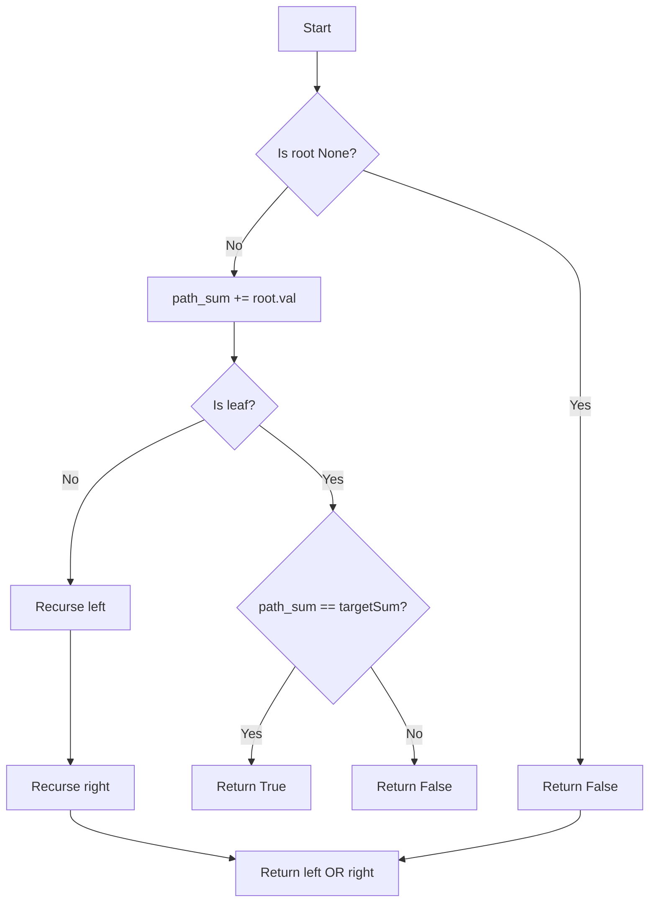

# LC 112 Path Sum

Given a binary tree and a target sum, determine whether there exists a root-to-leaf path whose node values sum to the target.

## Problem Statement

You are given the root of a binary tree and an integer `targetSum`. Write a function `hasPathSum(root, targetSum)` that returns `True` if there is a path from root to a leaf where the sum of node values equals `targetSum`, and `False` otherwise.

A **binary tree node** is defined as:

```python
class TreeNode:
    def __init__(self, val=0, left=None, right=None):
        self.val = val
        self.left = left
        self.right = right
```

## Theory

We can solve this with a recursive DFS. At each node, we add its value to the running sum. If we reach a leaf (both children `None`), we check if the running sum equals the target. Otherwise, we recurse on the left and right subtrees, returning `True` if either path succeeds.

## Algorithm

1. If `root` is `None`, return `False`.
2. Add `root.val` to `path_sum`.
3. If `root` is a leaf (both children `None`), return `path_sum == targetSum`.
4. Otherwise, return `traversal(root.left, path_sum) OR traversal(root.right, path_sum)`.

## Complexity Analysis

| Aspect | Complexity |
|--------|------------|
| Time   | **O(N)** – each node visited once |
| Space  | **O(H)** – recursion stack depth |

## Implementation

```python
# Definition for a binary tree node.
class TreeNode:
    def __init__(self, val=0, left=None, right=None):
        self.val = val
        self.left = left
        self.right = right

class Solution:
    def hasPathSum(self, root: TreeNode | None, targetSum: int) -> bool:
        def traversal(root, path_sum):
            if root is None:
                return False
            path_sum += root.val
            if root.left is None and root.right is None:
                return path_sum == targetSum
            return (
                traversal(root.left, path_sum) or
                traversal(root.right, path_sum)
            )

        return traversal(root, 0)
```

## Examples

### Example 1
```
Input:
     5
   /   \
  4     8
 /     / \
11    13  4
/ \       \
7   2       1

targetSum = 22
Path: 5 -> 4 -> 11 -> 2 = 22
Output: True
```

### Example 2
```
Input:
     1
   /   \
  2     3

targetSum = 5
No root-to-leaf path sums to 5.
Output: False
```

## Running the Tests

Run tests from the repository root:

```bash
PYTHONPATH=. python BinaryTree/LC_112/test.py
```

Expected output:

```
=== LC 112: Path Sum ===

PASS: hasPathSum([5, 4, 8, 11, None, 13, 4, 7, 2, None, None, None, 1], 22)
  Expected: True
  Got:      True

PASS: hasPathSum([1, 2, 3], 5)
  Expected: False
  Got:      False

PASS: hasPathSum([1, 2], 3)
  Expected: True
  Got:      True

PASS: hasPathSum([1], 1)
  Expected: True
  Got:      True

PASS: hasPathSum([], 0)
  Expected: False
  Got:      False

All LC_112 tests passed.
```

## File Structure

```
BinaryTree/
└── LC_112/
    ├── code.py    # TreeNode and Solution implementation
    ├── test.py    # Unit tests
    └── README.md  # Documentation
```


