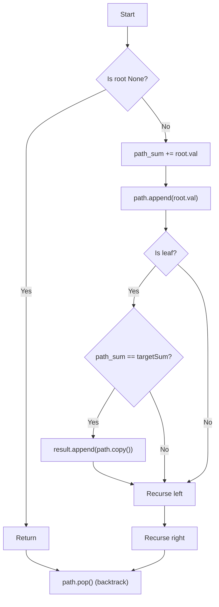

# LC 113 Path Sum II

Given a binary tree and a target sum, return all root-to-leaf paths whose node values sum to the target.

## Problem Statement

You are given the root of a binary tree and an integer `targetSum`. Write a function `pathSum(root, targetSum)` that returns a list of all root-to-leaf paths (as lists of node values) where the sum of node values equals `targetSum`.

A **binary tree node** is defined as:

```python
class TreeNode:
    def __init__(self, val=0, left=None, right=None):
        self.val = val
        self.left = left
        self.right = right
```

## Theory

We can solve this with a recursive DFS. At each node, we add its value to the running sum and append it to the current path. If we reach a leaf (both children `None`) and the running sum equals the target, we record a copy of the current path. Otherwise, we recurse on the left and right subtrees. After exploring both children, we backtrack by popping the current node from the path.

## Algorithm

1. Initialize `result = []`.
2. Define a recursive helper `traversal(root, path_sum, path)`:
   a. If `root` is `None`, return.
   b. Add `root.val` to `path_sum` and append `root.val` to `path`.
   c. If `root` is a leaf (both children `None`):
      - If `path_sum == targetSum`, append a copy of `path` to `result`.
   d. Recurse on `root.left` and `root.right`.
   e. Pop the last element from `path` (backtrack).
3. Call `traversal(root, 0, [])`.
4. Return `result`.

## Complexity Analysis

| Aspect | Complexity |
|--------|------------|
| Time   | **O(N^2)** in worst case (copying paths) – but typically **O(N)** for traversal |
| Space  | **O(H)** – recursion stack depth (excluding output) |

## Implementation

```python
# Definition for a binary tree node.
class TreeNode:
    def __init__(self, val=0, left=None, right=None):
        self.val = val
        self.left = left
        self.right = right

class Solution:
    def pathSum(self, root: TreeNode | None, targetSum: int) -> list[list[int]]:
        result = []

        def traversal(root, path_sum, path):
            if root is None:
                return

            path_sum += root.val
            path.append(root.val)

            if root.left is None and root.right is None:
                if path_sum == targetSum:
                    result.append(path.copy())

            traversal(root.left, path_sum, path)
            traversal(root.right, path_sum, path)

            path.pop()

        traversal(root, 0, [])
        return result
```

## Examples

### Example 1
```
Input:
     5
   /   \
  4     8
 /     / \
11    13  4
/ \       \
7   2       1

targetSum = 22
Paths: [5,4,11,2] and [5,8,4,5]
Output: [[5,4,11,2],[5,8,4,5]]
```

### Example 2
```
Input:
     1
   /   \
  2     3

targetSum = 5
No root-to-leaf path sums to 5.
Output: []
```

## Running the Tests

Run tests from the repository root:

```bash
PYTHONPATH=. python BinaryTree/LC_113/test.py
```

Expected output:

```
=== LC 113: Path Sum II ===

PASS: pathSum([5, 4, 8, 11, None, 13, 4, 7, 2, None, None, 5, 1], 22)
  Expected: [[5, 4, 11, 2], [5, 8, 4, 5]]
  Got:      [[5, 4, 11, 2], [5, 8, 4, 5]]

PASS: pathSum([1, 2, 3], 5)
  Expected: []
  Got:      []

PASS: pathSum([1, 2], 3)
  Expected: [[1, 2]]
  Got:      [[1, 2]]

PASS: pathSum([1], 1)
  Expected: [[1]]
  Got:      [[1]]

PASS: pathSum([], 0)
  Expected: []
  Got:      []

All LC_113 tests passed.
```

## File Structure

```
BinaryTree/
└── LC_113/
    ├── code.py    # TreeNode and Solution implementation
    ├── test.py    # Unit tests
    └── README.md  # Documentation
```


