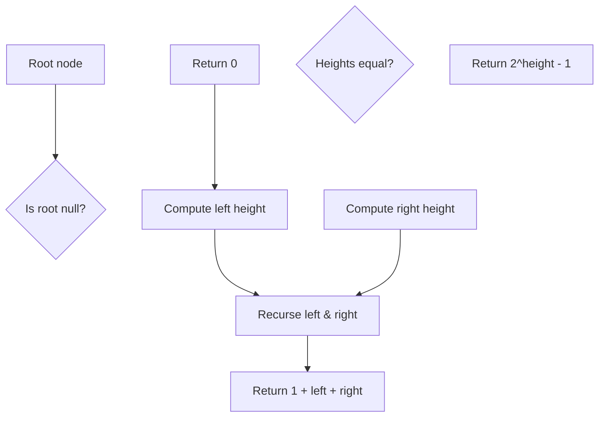

# LC 222 - Count Complete Tree Nodes

Given the root of a complete binary tree, return the number of nodes in the tree.

## Problem Statement

A complete binary tree has the following properties:
* Every level is completely filled with nodes, except possibly the last level.
* All nodes in the last level are as far left as possible.
The number of nodes can be between `1` and `2^h` (inclusive) at the last level, where `h` is the height of the tree.

Design an algorithm that runs in less than `O(n)` time complexity.

## Examples

### Example 1
```
Input: [1,2,3,4,5,6]
Output: 6
```
### Example 2
```
Input: []
Output: 0
```
### Example 3
```
Input: [1]
Output: 1
```

## Constraints

* The number of nodes in the tree is in the range `[0, 5 * 10^4]`.
* `0 <= Node.val <= 5 * 10^4`
* The tree is guaranteed to be complete.

## Algorithm

The solution uses a recursive approach that leverages the properties of a complete binary tree:
1. Compute the heights of the left and right sub‑trees of the current node.
2. If the heights are equal, the subtree is a full binary tree. The number of nodes in a full binary tree of height `h` is `2^h - 1`.
3. If the heights differ, the tree is not full. Recursively count nodes in the left and right sub‑trees and add 1 for the current node.

## Implementation

```python
class Solution:
    def countNodes(self, root: TreeNode | None) -> int:
        if root is None:
            return 0
        left = root
        right = root
        left_height = 0
        right_height = 0
        while left:
            left_height += 1
            left = left.left
        while right:
            right_height += 1
            right = right.right
        if left_height == right_height:
            return (2 ** left_height) - 1
        return 1 + self.countNodes(root.left) + self.countNodes(root.right)
```

## Running the Tests

The `test.py` file tests the solution with three cases:

- A complete tree with six nodes.
- An empty tree.
- A single‑node tree.

Run tests from the repository root:

```bash
PYTHONPATH=. python BinaryTree/LC_222/test.py
```

Expected output:

```
All LC_222 tests passed.
```

## File Structure

```
BinaryTree/
└── LC_222/
    ├── code.py    # TreeNode and Solution implementation
    ├── test.py    # Unit tests
    └── README.md  # Documentation
```

