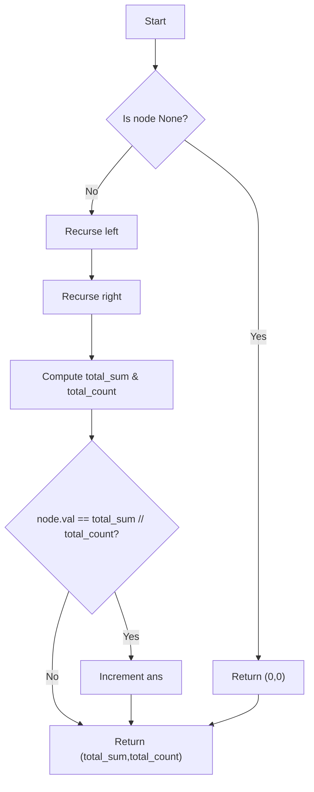

# LC 2265 Count Nodes Equal to Average of Subtree

Given a binary tree, count the number of nodes whose value is equal to the average of the values in its subtree (including itself).

## Problem Statement

You are given the root of a binary tree. Write a function `averageOfSubtree(root)` that returns the number of nodes where `node.val == (sum of subtree) / (count of subtree)` (integer division).

A **binary tree node** is defined as:

```python
class TreeNode:
    def __init__(self, val=0, left=None, right=None):
        self.val = val
        self.left = left
        self.right = right
```

## Theory

For each node, we need the sum and count of all nodes in its subtree. We can compute both in a single post-order DFS. The helper returns `(sum, count)` for the subtree rooted at `node`. We then check if `node.val == sum // count` and increment a counter.

## Algorithm

1. Initialize `ans = 0`.
2. Define a recursive helper `dfs(node)` returning `(sum, count)`:
   a. If `node` is `None`, return `(0, 0)`.
   b. Recursively get `(left_sum, left_count)` from `dfs(node.left)`.
   c. Recursively get `(right_sum, right_count)` from `dfs(node.right)`.
   d. Compute `total_sum = left_sum + right_sum + node.val`.
   e. Compute `total_count = left_count + right_count + 1`.
   f. If `node.val == total_sum // total_count`, increment `ans`.
   g. Return `(total_sum, total_count)`.
3. Call `dfs(root)`.
4. Return `ans`.

## Complexity Analysis

| Aspect | Complexity |
|--------|------------|
| Time   | **O(N)** – each node visited once |
| Space  | **O(H)** – recursion stack depth |

## Implementation

```python
# Definition for a binary tree node.
class TreeNode:
    def __init__(self, val=0, left=None, right=None):
        self.val = val
        self.left = left
        self.right = right

class Solution:
    def averageOfSubtree(self, root: TreeNode) -> int:
        ans = 0

        def dfs(root):
            nonlocal ans
            if root is None:
                return 0, 0
            left_sum, left_count = dfs(root.left)
            right_sum, right_count = dfs(root.right)
            total_sum = left_sum + right_sum + root.val
            total_count = left_count + right_count + 1

            if root.val == total_sum // total_count:
                ans += 1
            return total_sum, total_count

        dfs(root)

        return ans
```

## Examples

### Example 1
```
Input:
     4
   /   \
  8     5
 / \     \
0   1     6

Output: 5
```

### Example 2
```
Input:
     1

Output: 1
```

## Running the Tests

Run tests from the repository root:

```bash
PYTHONPATH=. python BinaryTree/LC_2265/test.py
```

Expected output:

```
=== LC 2265: Count Nodes Equal to Average of Subtree ===

PASS: averageOfSubtree([4, 8, 5, 0, 1, None, 6])
  Expected: 5
  Got:      5

PASS: averageOfSubtree([1])
  Expected: 1
  Got:      1

PASS: averageOfSubtree([])
  Expected: 0
  Got:      0

PASS: averageOfSubtree([2, 4, 6, None, None, 2, 3])
  Expected: 3
  Got:      3

All LC_2265 tests passed.
```

## File Structure

```
BinaryTree/
└── LC_2265/
    ├── code.py    # TreeNode and Solution implementation
    ├── test.py    # Unit tests
    └── README.md  # Documentation
```


