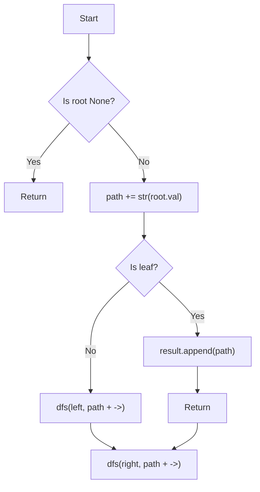

# LC 257 Binary Tree Paths

Given a binary tree, return all root-to-leaf paths as strings.

## Problem Statement

You are given the root of a binary tree. Write a function `binaryTreePaths(root)` that returns a list of strings, each representing a root-to-leaf path where node values are separated by `"->"`.

A **binary tree node** is defined as:

```python
class TreeNode:
    def __init__(self, val=0, left=None, right=None):
        self.val = val
        self.left = left
        self.right = right
```

## Theory

We can solve this with a recursive DFS. At each node, we append its value to the current path string. If the node is a leaf (both children `None`), we record the path. Otherwise, we recurse on the left and right children, appending `"->"` to the path.

## Algorithm

1. Initialize `result = []`.
2. Define a recursive helper `dfs(node, path)`:
   a. If `node` is `None`, return.
   b. Append `str(node.val)` to `path`.
   c. If `node` is a leaf (both children `None`), append `path` to `result` and return.
   d. Recurse on `node.left` with `path + "->"`.
   e. Recurse on `node.right` with `path + "->"`.
3. Call `dfs(root, "")`.
4. Return `result`.

## Complexity Analysis

| Aspect | Complexity |
|--------|------------|
| Time   | **O(N^2)** in worst case (string concatenation) – but typically **O(N)** for traversal |
| Space  | **O(H)** – recursion stack depth (excluding output) |

## Implementation

```python
# Definition for a binary tree node.
class TreeNode:
    def __init__(self, val=0, left=None, right=None):
        self.val = val
        self.left = left
        self.right = right

class Solution:
    def binaryTreePaths(self, root: TreeNode | None) -> list[str]:
        result = []

        def dfs(root, path):
            if not root:
                return
            path += str(root.val)
            if root.left is None and root.right is None:
                result.append(path)
                return
            dfs(root.left, path + "->")
            dfs(root.right, path + "->")

        dfs(root, "")
        return result
```

## Examples

### Example 1
```
Input:
     1
   /   \
  2     3
   \
    5

Paths: "1->2->5" and "1->3"
Output: ["1->2->5", "1->3"]
```

### Example 2
```
Input:
     1

Output: ["1"]
```

## Running the Tests

Run tests from the repository root:

```bash
PYTHONPATH=. python BinaryTree/LC_257/test.py
```

Expected output:

```
=== LC 257: Binary Tree Paths ===

PASS: binaryTreePaths([1, 2, 3, None, 5])
  Expected: ['1->2->5', '1->3']
  Got:      ['1->2->5', '1->3']

PASS: binaryTreePaths([1])
  Expected: ['1']
  Got:      ['1']

PASS: binaryTreePaths([])
  Expected: []
  Got:      []

All LC_257 tests passed.
```

## File Structure

```
BinaryTree/
└── LC_257/
    ├── code.py    # TreeNode and Solution implementation
    ├── test.py    # Unit tests
    └── README.md  # Documentation
```


