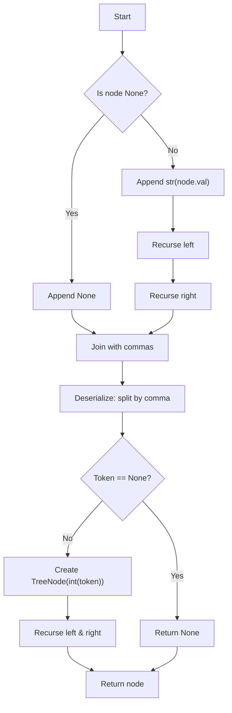

# LC 297 Serialize and Deserialize Binary Tree

Design an algorithm to serialize and deserialize a binary tree. Serialization converts a tree into a string; deserialization reconstructs the tree from the string.

## Problem Statement

You are given the root of a binary tree. Implement two methods:
- `serialize(root)` that encodes a tree to a single string.
- `deserialize(data)` that decodes the string back to the original tree structure.

A **binary tree node** is defined as:

```python
class TreeNode:
    def __init__(self, x):
        self.val = x
        self.left = None
        self.right = None
```

We use the string `"None"` to represent `None` (null) nodes, separated by commas.

## Theory

We can serialize the tree using **preorder traversal**. For each node, we append its value; for `None`, we append `"None"`. This produces a unique comma-separated string that can be deserialized by reading values in the same preorder order.

Deserialization splits the string by commas and reads tokens sequentially: if the current token is `"None"`, return `None`; otherwise create a node with that integer value and recursively build left and right subtrees.

## Algorithm

### Serialize
1. Initialize an empty list `ans`.
2. Define a recursive helper `dfs(node)`:
   a. If `node` is `None`, append `"None"` and return.
   b. Append `str(node.val)`.
   c. Recurse on `node.left`.
   d. Recurse on `node.right`.
3. Call `dfs(root)`.
4. Return `",".join(ans)`.

### Deserialize
1. Split `data` by `","` into `arr`.
2. Initialize index pointer `i = 0`.
3. Define a recursive helper `dfs()`:
   a. If `arr[i] == "None"`, increment `i` and return `None`.
   b. Create `TreeNode(int(arr[i]))`, increment `i`.
   c. Set `root.left = dfs()`.
   d. Set `root.right = dfs()`.
   e. Return `root`.
4. Return `dfs()`.

## Complexity Analysis

| Aspect | Complexity |
|--------|------------|
| Time   | **O(N)** – each node visited once |
| Space  | **O(N)** – serialized string and recursion stack |

## Implementation

```python
# Definition for a binary tree node.
class TreeNode:
    def __init__(self, x):
        self.val = x
        self.left = None
        self.right = None

class Codec:
    def serialize(self, root):
        ans = []

        def dfs(root):
            if root is None:
                ans.append("None")
                return

            ans.append(str(root.val))
            dfs(root.left)
            dfs(root.right)

        dfs(root)
        return ",".join(ans)

    def deserialize(self, data):
        arr = data.split(",")
        i = 0

        def dfs():
            nonlocal i

            if arr[i] == "None":
                i += 1
                return None

            root = TreeNode(int(arr[i]))
            i += 1

            root.left = dfs()
            root.right = dfs()

            return root

        return dfs()
```

## Examples

### Example 1
```
Input:
     1
   /   \
  2     3

Serialized: "1,2,None,None,3,None,None"
Deserialized: same tree
```

### Example 2
```
Input: Empty tree

Serialized: "None"
Deserialized: None
```

## Running the Tests

Run tests from the repository root:

```bash
PYTHONPATH=. python BinaryTree/LC_297/test.py
```

Expected output:

```
=== LC 297: Serialize and Deserialize Binary Tree ===

PASS: serialize/deserialize([1, 2, 3])
  Serialized:   1,2,None,None,3,None,None
  Deserialized: [1, 2, 3]

PASS: serialize/deserialize([1, 2, 3, 4, 5, 6, 7])
  Serialized:   1,2,4,None,None,5,None,None,3,6,None,None,7,None,None
  Deserialized: [1, 2, 3, 4, 5, 6, 7]

PASS: serialize/deserialize([1])
  Serialized:   1,None,None
  Deserialized: [1]

PASS: serialize/deserialize([])
  Serialized:   None
  Deserialized: []

PASS: serialize/deserialize([1, None, 2])
  Serialized:   1,None,2,None,None
  Deserialized: [1, None, 2]

All LC_297 tests passed.
```

## File Structure

```
BinaryTree/
└── LC_297/
    ├── code.py    # TreeNode, Codec implementation
    ├── test.py    # Unit tests
    └── README.md  # Documentation
```


