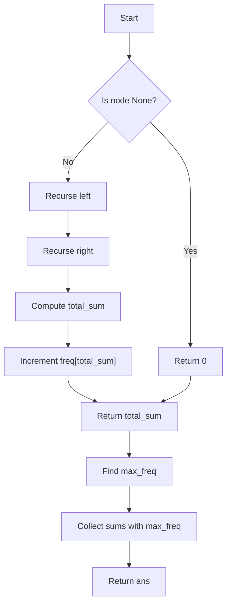

# LC 508 Most Frequent Subtree Sum

Given a binary tree, find the most frequent subtree sum. The subtree sum of a node is the sum of all node values in the subtree rooted at that node (including the node itself). Return all sums that occur with the highest frequency.

## Problem Statement

You are given the root of a binary tree. Write a function `findFrequentTreeSum(root)` that returns a list of the most frequent subtree sums.

A **binary tree node** is defined as:

```python
class TreeNode:
    def __init__(self, val=0, left=None, right=None):
        self.val = val
        self.left = left
        self.right = right
```

## Theory

For each node, we need the sum of its entire subtree. We can compute this in a single post-order DFS. The helper returns the subtree sum for the node. We record each sum in a frequency dictionary. After traversal, we find the maximum frequency and collect all sums with that frequency.

## Algorithm

1. If the tree is empty, return an empty list.
2. Initialize `freq = {}` and `ans = []`.
3. Define a recursive helper `dfs(node)`:
   a. If `node` is `None`, return 0.
   b. Recursively compute `left_sum = dfs(node.left)`.
   c. Recursively compute `right_sum = dfs(node.right)`.
   d. Compute `total_sum = left_sum + right_sum + node.val`.
   e. Increment `freq[total_sum]`.
   f. Return `total_sum`.
4. Call `dfs(root)`.
5. Find `max_freq = max(freq.values())`.
6. Collect all keys with value == `max_freq` into `ans`.
7. Return `ans`.

## Complexity Analysis

| Aspect | Complexity |
|--------|------------|
| Time   | **O(N)** – each node visited once |
| Space  | **O(N)** – frequency dictionary and recursion stack |

## Implementation

```python
# Definition for a binary tree node.
class TreeNode:
    def __init__(self, val=0, left=None, right=None):
        self.val = val
        self.left = left
        self.right = right

class Solution:
    def findFrequentTreeSum(self, root: TreeNode | None) -> list[int]:
        ans = []
        freq = {}

        def dfs(root):
            if root is None:
                return 0
            left_sum = dfs(root.left)
            right_sum = dfs(root.right)
            total_sum = left_sum + right_sum + root.val

            freq[total_sum] = freq.get(total_sum, 0) + 1

            return total_sum

        dfs(root)

        if not freq:
            return []

        max_freq = max(freq.values())
        for subtree_sum, count in freq.items():
            if count == max_freq:
                ans.append(subtree_sum)

        return ans
```

## Examples

### Example 1
```
Input:
     5
   /   \
  2    -3

Subtree sums:
Node 2: 2
Node -3: -3
Node 5: 5+2-3 = 4

All sums occur once, so return [2, -3, 4] (order may vary).
```

### Example 2
```
Input:
     5
   /   \
  2    -5

Subtree sums:
Node 2: 2
Node -5: -5
Node 5: 5+2-5 = 2

Most frequent sum is 2 (occurs twice).
Output: [2]
```

## Running the Tests

Run tests from the repository root:

```bash
PYTHONPATH=. python BinaryTree/LC_508/test.py
```

Expected output:

```
=== LC 508: Most Frequent Subtree Sum ===

PASS: findFrequentTreeSum([5, 2, -3])
  Expected: [2, -3, 4]
  Got:      [2, -3, 4]

PASS: findFrequentTreeSum([5, 2, -5])
  Expected: [2]
  Got:      [2]

PASS: findFrequentTreeSum([1])
  Expected: [1]
  Got:      [1]

PASS: findFrequentTreeSum([])
  Expected: []
  Got:      []

All LC_508 tests passed.
```

## File Structure

```
BinaryTree/
└── LC_508/
    ├── code.py    # TreeNode and Solution implementation
    ├── test.py    # Unit tests
    └── README.md  # Documentation
```


