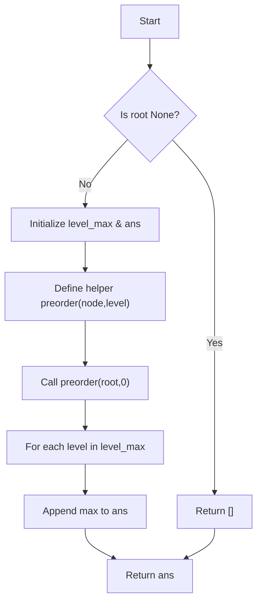

# LC 515 Find Largest Value in Each Tree Row

Given a binary tree, return a list of the largest value in each row (level) of the tree.

## Problem Statement

You are given the root of a binary tree. Write a function `largestValues(root)` that returns a list of the maximum value at each level from top to bottom.

A **binary tree node** is defined as:

```python
class TreeNode:
    def __init__(self, val=0, left=None, right=None):
        self.val = val
        self.left = left
        self.right = right
```

## Theory

To find the largest value at each level, we need to:
1. Traverse the tree and track the maximum value encountered at each depth.
2. Return a list of these maximums in order of increasing depth.

We can achieve this using **preorder traversal** (depth‑first search). While traversing, we maintain a dictionary `level_max` where:
- `level_max[level]` stores the maximum node value seen at that `level`.

For each node, we update `level_max[level] = max(level_max.get(level, node.val), node.val)`. After the traversal, we iterate through `level_max` in order and collect the maximums into a list.

## Algorithm

1. If the tree is empty (`root` is `None`), return an empty list.
2. Initialize `level_max` as an empty dictionary and `ans` as an empty list.
3. Define a recursive helper function `preorder(node, level)`:
   a. If `node` is `None`, return.
   b. Update `level_max[level]` to the max of its current value (or `node.val` if not present) and `node.val`.
   c. Recursively call `preorder(node.left, level + 1)`.
   d. Recursively call `preorder(node.right, level + 1)`.
4. Call `preorder(root, 0)`.
5. For each `level` in `level_max`, append `level_max[level]` to `ans`.
6. Return `ans`.

## Complexity Analysis

| Aspect | Complexity |
|--------|------------|
| Time   | **O(N)** – each node is visited exactly once |
| Space  | **O(H)** – recursion stack depth equal to tree height (worst‑case **O(N)** for a skewed tree) |

## Implementation

```python
# Definition for a binary tree node.
class TreeNode:
    def __init__(self, val=0, left=None, right=None):
        self.val = val
        self.left = left
        self.right = right

class Solution:
    def largestValues(self, root: TreeNode | None) -> list[int]:
        level_max = {}
        ans = []
        def preorder(node, level):
            if node is None :
                return

            level_max[level] = max(level_max.get(level, node.val), node.val)

            preorder(node.left, level + 1)
            preorder(node.right, level + 1)

        preorder(root, 0)

        for level in level_max :
            ans.append(level_max[level])
        return ans
```

## Examples

### Example 1
```
Input:
     1
   /   \
  3     2
 / \   / \
5   3 None 9

Level maximums:
Depth 0: max = 1
Depth 1: max = 3
Depth 2: max = 9

Output: [1, 3, 9]
```

### Example 2
```
Input:
     1
   / \
  2   3

Level maximums:
Depth 0: max = 1
Depth 1: max = 3

Output: [1, 3]
```

### Example 3
```
Input:
     1

Output: [1]
```

### Example 4
```
Input: Empty tree

Output: []
```

## Running the Tests

The `test.py` file tests the solution with several cases:

- A balanced tree of three levels.
- A single‑node tree.
- An empty tree.

Run tests from the repository root:

```bash
PYTHONPATH=. python BinaryTree/LC_515/test.py
```

Expected output:

```
=== LC 515: Find Largest Value in Each Tree Row ===

PASS: largestValues([1, 3, 2, 5, 3, None, 9])
  Expected: [1, 3, 9]
  Got:      [1, 3, 9]

PASS: largestValues([1, 2, 3])
  Expected: [1, 3]
  Got:      [1, 3]

PASS: largestValues([1])
  Expected: [1]
  Got:      [1]

PASS: largestValues([])
  Expected: []
  Got:      []

All LC_515 tests passed.
```

## File Structure

```
BinaryTree/
└── LC_515/
    ├── code.py    # TreeNode and Solution implementation
    ├── test.py    # Unit tests
    └── README.md  # Documentation
```


