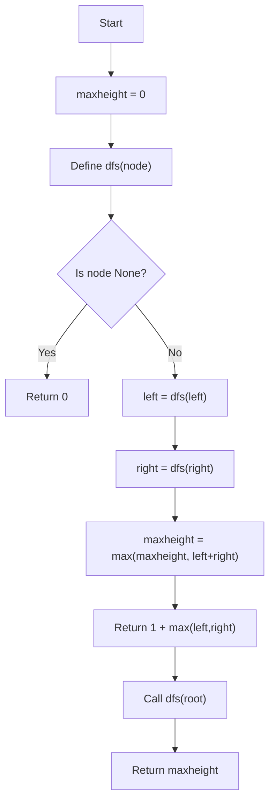

# LC 543 Diameter of Binary Tree

Given a binary tree, return its diameter. The diameter is the length of the longest path between any two nodes in the tree, measured in number of edges. This path may or may not pass through the root.

## Problem Statement

You are given the root of a binary tree. Write a function `diameterOfBinaryTree(root)` that returns the diameter of the tree.

A **binary tree node** is defined as:

```python
class TreeNode:
    def __init__(self, val=0, left=None, right=None):
        self.val = val
        self.left = left
        self.right = right
```

## Theory

The diameter of a tree is the maximum of:
- The diameter of the left subtree.
- The diameter of the right subtree.
- The longest path passing through the current node: `left_height + right_height` (where height is measured in edges).

We can compute this in a single post-order DFS. The helper returns the height of the subtree (in edges). While computing, we update a global `maxheight` with `left_height + right_height`.

## Algorithm

1. Initialize `maxheight = 0`.
2. Define a recursive helper `dfs(node)`:
   a. If `node` is `None`, return 0.
   b. `left_height = dfs(node.left)`.
   c. `right_height = dfs(node.right)`.
   d. `maxheight = max(maxheight, left_height + right_height)`.
   e. Return `1 + max(left_height, right_height)`.
3. Call `dfs(root)`.
4. Return `maxheight`.

## Complexity Analysis

| Aspect | Complexity |
|--------|------------|
| Time   | **O(N)** – each node visited once |
| Space  | **O(H)** – recursion stack depth |

## Implementation

```python
from typing import Optional

# Definition for a binary tree node.
class TreeNode:
    def __init__(self, val=0, left=None, right=None):
        self.val = val
        self.left = left
        self.right = right

class Solution:
    def diameterOfBinaryTree(self, root: Optional[TreeNode]) -> int:
        maxheight = 0

        def dfs(root):
            nonlocal maxheight
            if root is None:
                return 0
            left_height = dfs(root.left)
            right_height = dfs(root.right)
            maxheight = max(maxheight, left_height + right_height)

            return 1 + max(left_height, right_height)

        dfs(root)
        return maxheight
```

## Examples

### Example 1
```
Input:
     1
   /   \
  2     3

Diameter: 2 (path 2 -> 1 -> 3)
Output: 2
```

### Example 2
```
Input:
     1
   /   \
  2     3
 / \
4   5

Diameter: 3 (path 4 -> 2 -> 1 -> 3)
Output: 3
```

## Running the Tests

Run tests from the repository root:

```bash
PYTHONPATH=. python BinaryTree/LC_543/test.py
```

Expected output:

```
=== LC 543: Diameter of Binary Tree ===

PASS: diameterOfBinaryTree([1, 2, 3])
  Expected: 2
  Got:      2

PASS: diameterOfBinaryTree([1, 2, 3, 4, 5])
  Expected: 3
  Got:      3

PASS: diameterOfBinaryTree([1])
  Expected: 0
  Got:      0

PASS: diameterOfBinaryTree([])
  Expected: 0
  Got:      0

PASS: diameterOfBinaryTree([1, 2, None, 3, None, 4])
  Expected: 3
  Got:      3

All LC_543 tests passed.
```

## File Structure

```
BinaryTree/
└── LC_543/
    ├── code.py    # TreeNode and Solution implementation
    ├── test.py    # Unit tests
    └── README.md  # Documentation
```


