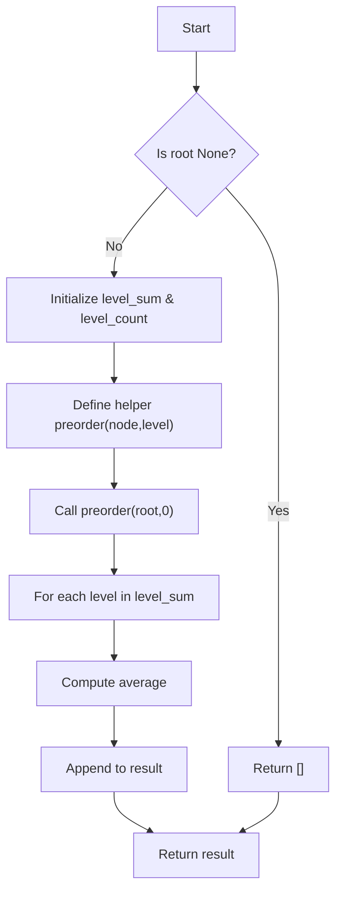

# LC 637 Average of Levels in Binary Tree

Given a binary tree, return the average value of the nodes at each level of the tree (as a list of averages from top to bottom).

## Problem Statement

You are given the root of a binary tree. Write a function `averageOfLevels(root)` that returns a list of averages, where the i-th element is the average value of the nodes at depth i.

A **binary tree node** is defined as:

```python
class TreeNode:
    def __init__(self, val=0, left=None, right=None):
        self.val = val
        self.left = left
        self.right = right
```

The depth (level) of a node is the number of edges from the root to that node, with the root at depth 0.

## Theory

To compute the average of each level, we need to:

1. Traverse the tree and group nodes by their depth.
2. For each depth, sum the values of all nodes at that depth and divide by the number of nodes.
3. Return the list of averages in order of increasing depth.

We can achieve this using **preorder traversal** (depth‑first search). While traversing, we maintain two dictionaries:

- `level_sum[level]`: cumulative sum of node values at `level`.
- `level_count[level]`: count of nodes at `level`.

After the traversal, we compute the average for each level by dividing `level_sum[level]` by `level_count[level]`.

## Algorithm

1. If the tree is empty (`root` is `None`), return an empty list.
2. Initialize `level_sum` and `level_count` as empty dictionaries.
3. Define a recursive helper function `preorder(node, level)`:
   a. If `node` is `None`, return.
   b. Increment `level_sum[level]` by `node.val`.
   c. Increment `level_count[level]` by 1.
   d. Recursively call `preorder(node.left, level + 1)`.
   e. Recursively call `preorder(node.right, level + 1)`.
4. Call `preorder(root, 0)`.
5. For each `level` in `level_sum`, compute the average and append it to the result list.
6. Return the result list.

## Complexity Analysis

| Aspect | Complexity |
|--------|------------|
| Time   | **O(N)** – each node is visited exactly once |
| Space  | **O(H)** – recursion stack depth equal to tree height (worst‑case **O(N)** for a skewed tree) |

## Implementation

```python
# Definition for a binary tree node.
class TreeNode:
    def __init__(self, val=0, left=None, right=None):
        self.val = val
        self.left = left
        self.right = right

class Solution:
    def averageOfLevels(self, root: TreeNode | None) -> list[float]:
        level_sum = {}
        level_count = {}
        ans = []

        def preorder(node, level):
            if node is None:
                return
            
            level_sum[level] = level_sum.get(level, 0) + node.val
            level_count[level] = level_count.get(level, 0) + 1

            preorder(node.left, level + 1)
            preorder(node.right, level + 1)
        
        preorder(root, 0)

        for level in level_sum:
            avg = level_sum[level] / level_count[level]
            ans.append(avg)
        return ans
```

## Examples

### Example 1
```
Input:
     3
   /   \
  9     20
       / \
      15   7

Level sums and counts:
Depth 0: sum = 3, count = 1 → average = 3.0
Depth 1: sum = 9 + 20 = 29, count = 2 → average = 14.5
Depth 2: sum = 15 + 7 = 18, count = 2 → average = 11.0

Output: [3.0, 14.5, 11.0]
```

### Example 2
```
Input:
     1
      \
       2
        \
         3
          \
           4

Level averages:
Depth 0: 1.0
Depth 1: 2.0
Depth 2: 3.0
Depth 3: 4.0

Output: [1.0, 2.0, 3.0, 4.0]
```

### Example 3
```
Input: Empty tree

Output: []
```

## Running the Tests

The `test.py` file tests the solution with several cases:

- A balanced tree of three levels.
- A single‑node tree.
- An empty tree.

Run tests from the repository root:

```bash
PYTHONPATH=. python BinaryTree/LC_637/test.py
```

Expected output:

```
=== LC 637: Average of Levels in Binary Tree ===

PASS: averageOfLevels([3, 9, 20, None, None, 15, 7])
  Expected: [3.0, 14.5, 11.0]
  Got:      [3.0, 14.5, 11.0]

PASS: averageOfLevels([3, 9, 20, None, None, 15, 7])
  Expected: [3.0, 14.5, 11.0]
  Got:      [3.0, 14.5, 11.0]

PASS: averageOfLevels([3, 9, 20, None, None, 15, 7])
  Expected: [3.0, 14.5, 11.0]
  Got:      [3.0, 14.5, 11.0]

PASS: averageOfLevels([1])
  Expected: [1.0]
  Got:      [1.0]

PASS: averageOfLevels([])
  Expected: []
  Got:      []

All LC_637 tests passed.
```

## File Structure

```
BinaryTree/
└── LC_637/
    ├── code.py    # TreeNode and Solution implementation
    ├── test.py    # Unit tests
    └── README.md  # Documentation
```


