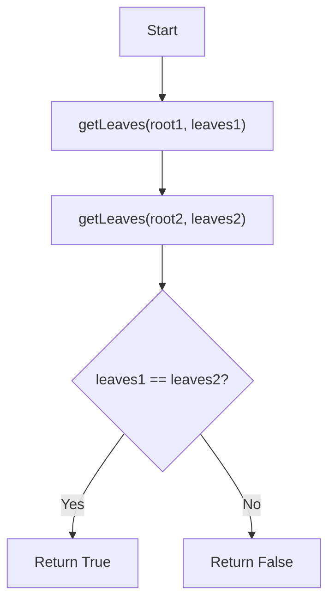

# LC 872 Leaf-Similar Trees

Consider all the leaves of a binary tree, from left to right order. Two binary trees are considered leaf-similar if their leaf value sequence is the same.

## Problem Statement

You are given the roots of two binary trees `root1` and `root2`. Write a function `leafSimilar(root1, root2)` that returns `True` if the two trees are leaf-similar and `False` otherwise.

A **binary tree node** is defined as:

```python
class TreeNode:
    def __init__(self, val=0, left=None, right=None):
        self.val = val
        self.left = left
        self.right = right
```

## Theory

We can collect the leaves of each tree in left-to-right order using a DFS. A node is a leaf if both children are `None`. We then compare the two lists of leaf values.

## Algorithm

1. Define a helper `getLeaves(root, result)`:
   a. If `root` is `None`, return.
   b. If `root` is a leaf (both children `None`), append `root.val` to `result`.
   c. Recurse on `root.left` and `root.right`.
2. Collect leaves of `root1` into `leaves1`.
3. Collect leaves of `root2` into `leaves2`.
4. Return `leaves1 == leaves2`.

## Complexity Analysis

| Aspect | Complexity |
|--------|------------|
| Time   | **O(N + M)** – each node visited once |
| Space  | **O(H1 + H2)** – recursion stack depth |

## Implementation

```python
# Definition for a binary tree node.
class TreeNode:
    def __init__(self, val=0, left=None, right=None):
        self.val = val
        self.left = left
        self.right = right

class Solution:
    def leafSimilar(self, root1: TreeNode | None, root2: TreeNode | None) -> bool:
        def getLeaves(root, result):
            if root is None:
                return
            if root.left is None and root.right is None:
                result.append(root.val)
            getLeaves(root.left, result)
            getLeaves(root.right, result)

        leaves1 = []
        leaves2 = []

        getLeaves(root1, leaves1)
        getLeaves(root2, leaves2)

        return leaves1 == leaves2
```

## Examples

### Example 1
```
Tree1:
     3
   /   \
  5     1
 / \   / \
6   2 9   8
   / \
  7   4

Leaves: [6, 7, 4, 9, 8]

Tree2:
     3
   /   \
  1     5
 / \   / \
8   9 6   7
     / \
    4   2

Leaves: [8, 9, 6, 7, 4]? Not same order.
```

### Example 2
```
Input: root1 = [1], root2 = [1]

Leaves: [1] and [1]
Output: True
```

## Running the Tests

Run tests from the repository root:

```bash
PYTHONPATH=. python BinaryTree/LC_872/test.py
```

Expected output:

```
=== LC 872: Leaf-Similar Trees ===

PASS: leafSimilar([3, 5, 1, 6, 2, 9, 8, None, None, 7, 4], [3, 1, 5, 8, 9, 6, 7, 4, 2])
  Expected: False
  Got:      False

PASS: leafSimilar([1], [1])
  Expected: True
  Got:      True

PASS: leafSimilar([1], [2])
  Expected: False
  Got:      False

PASS: leafSimilar([], [])
  Expected: True
  Got:      True

PASS: leafSimilar([1, 2, 3], [1, 3, 2])
  Expected: False
  Got:      False

PASS: leafSimilar([1, 2, 3], [1, 2, 3])
  Expected: True
  Got:      True

All LC_872 tests passed.
```

## File Structure

```
BinaryTree/
└── LC_872/
    ├── code.py    # TreeNode and Solution implementation
    ├── test.py    # Unit tests
    └── README.md  # Documentation
```


