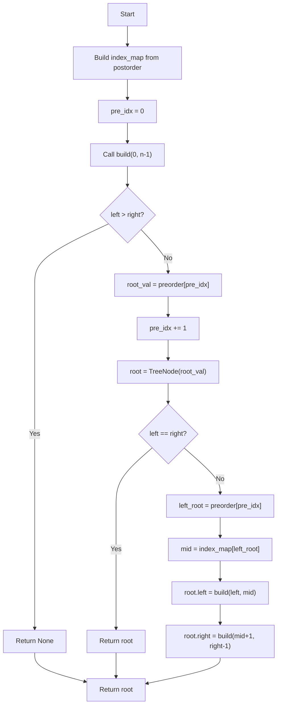

# LC 889 Construct Binary Tree from Preorder and Postorder Traversal

Given preorder and postorder traversals of a binary tree, construct the original binary tree. (The tree may not be unique; this constructs one valid tree.)

## Problem Statement

You are given two integer arrays `preorder` and `postorder` representing the preorder and postorder traversals of a binary tree. Write a function `constructFromPrePost(preorder, postorder)` that returns the root of the constructed tree.

A **binary tree node** is defined as:

```python
class TreeNode:
    def __init__(self, val=0, left=None, right=None):
        self.val = val
        self.left = left
        self.right = right
```

## Theory

In preorder, the first element is the root. The next element is the root of the left subtree. We find this left root in the postorder array; everything up to and including it forms the left subtree, and the rest (excluding the root) forms the right subtree.

We build a hash map from value to index in postorder for O(1) lookup. We track the current preorder index with a `nonlocal` variable.

## Algorithm

1. Build `index_map = {val: i for i, val in enumerate(postorder)}`.
2. Initialize `pre_idx = 0`.
3. Define a recursive helper `build(left, right)` (indices into postorder):
   a. If `left > right`, return `None`.
   b. `root_val = preorder[pre_idx]`; increment `pre_idx`.
   c. `root = TreeNode(root_val)`.
   d. If `left == right`, return `root` (leaf).
   e. `left_root = preorder[pre_idx]` (root of left subtree).
   f. `mid = index_map[left_root]`.
   g. `root.left = build(left, mid)`.
   h. `root.right = build(mid + 1, right - 1)`.
   i. Return `root`.
4. Return `build(0, len(preorder) - 1)`.

## Complexity Analysis

| Aspect | Complexity |
|--------|------------|
| Time   | **O(N)** – each node created once; hash map gives O(1) lookup |
| Space  | **O(N)** – hash map and recursion stack |

## Implementation

```python
# Definition for a binary tree node.
class TreeNode:
    def __init__(self, val=0, left=None, right=None):
        self.val = val
        self.left = left
        self.right = right

class Solution:
    def constructFromPrePost(self, preorder: list[int], postorder: list[int]) -> TreeNode | None:
        index_map = {val: i for i, val in enumerate(postorder)}
        pre_idx = 0

        def build(left, right):
            nonlocal pre_idx
            if left > right:
                return None
            root_val = preorder[pre_idx]
            pre_idx += 1

            root = TreeNode(root_val)

            if left == right:
                return root
            left_root = preorder[pre_idx]
            mid = index_map[left_root]

            root.left = build(left, mid)
            root.right = build(mid + 1, right - 1)

            return root

        return build(0, len(preorder) - 1)
```

## Examples

### Example 1
```
Preorder:  [1, 2, 4, 5, 3, 6, 7]
Postorder: [4, 5, 2, 6, 7, 3, 1]

Tree:
         1
       /   \
      2     3
     / \   / \
    4   5 6   7
```

### Example 2
```
Preorder:  [-1]
Postorder: [-1]

Tree: single node -1
```

## Running the Tests

Run tests from the repository root:

```bash
PYTHONPATH=. python BinaryTree/LC_889/test.py
```

Expected output:

```
=== LC 889: Construct Binary Tree from Preorder and Postorder Traversal ===

PASS: constructFromPrePost(preorder=[1, 2, 4, 5, 3, 6, 7], postorder=[4, 5, 2, 6, 7, 3, 1])
  Preorder:  [1, 2, 4, 5, 3, 6, 7] (expected [1, 2, 4, 5, 3, 6, 7])
  Postorder: [4, 5, 2, 6, 7, 3, 1] (expected [4, 5, 2, 6, 7, 3, 1])

PASS: constructFromPrePost(preorder=[-1], postorder=[-1])
  Preorder:  [-1] (expected [-1])
  Postorder: [-1] (expected [-1])

PASS: constructFromPrePost(preorder=[], postorder=[])
  Preorder:  [] (expected [])
  Postorder: [] (expected [])

PASS: constructFromPrePost(preorder=[1, 2, 3], postorder=[2, 3, 1])
  Preorder:  [1, 2, 3] (expected [1, 2, 3])
  Postorder: [2, 3, 1] (expected [2, 3, 1])

All LC_889 tests passed.
```

## File Structure

```
BinaryTree/
└── LC_889/
    ├── code.py    # TreeNode and Solution implementation
    ├── test.py    # Unit tests
    └── README.md  # Documentation
```


