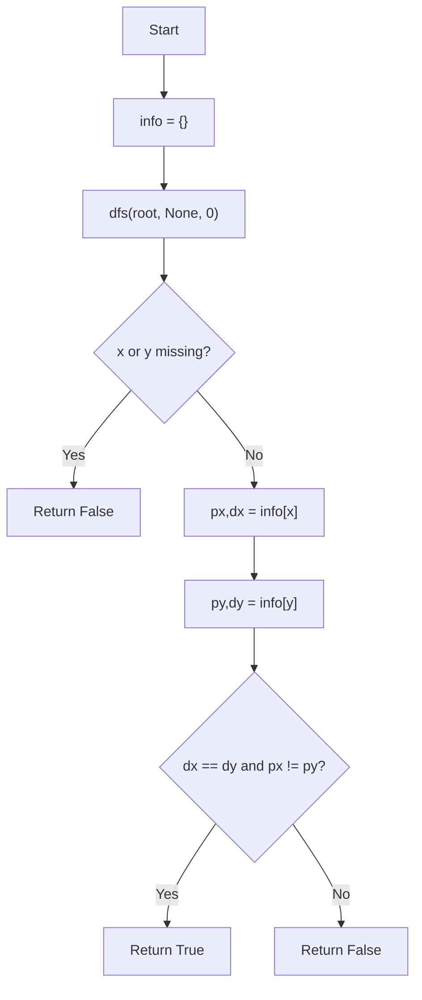

# LC 993 Cousins in Binary Tree

Given a binary tree and two nodes `x` and `y`, determine whether they are cousins. Two nodes are cousins if they are at the same depth but have different parents.

## Problem Statement

You are given the root of a binary tree and two integers `x` and `y`. Write a function `isCousins(root, x, y)` that returns `True` if nodes with values `x` and `y` are cousins, and `False` otherwise.

A **binary tree node** is defined as:

```python
class TreeNode:
    def __init__(self, val=0, left=None, right=None):
        self.val = val
        self.left = left
        self.right = right
```

## Theory

Two nodes are cousins if and only if:
1. They are at the same depth (level).
2. They have different parents.

We can find both pieces of information with a single DFS that records, for each target value, the `(parent, depth)` pair.

## Algorithm

1. Initialize `info = {}`.
2. Define a recursive helper `dfs(node, parent, depth)`:
   a. If `node` is `None`, return.
   b. If `node.val == x` or `node.val == y`, store `info[node.val] = (parent, depth)`.
   c. Recurse on `node.left` with `parent=node, depth+1`.
   d. Recurse on `node.right` with `parent=node, depth+1`.
3. Call `dfs(root, None, 0)`.
4. If either `x` or `y` not found, return `False`.
5. Extract `(px, dx)` and `(py, dy)`.
6. Return `dx == dy and px != py`.

## Complexity Analysis

| Aspect | Complexity |
|--------|------------|
| Time   | **O(N)** – each node visited once |
| Space  | **O(H)** – recursion stack depth |

## Implementation

```python
# Definition for a binary tree node.
class TreeNode:
    def __init__(self, val=0, left=None, right=None):
        self.val = val
        self.left = left
        self.right = right

class Solution:
    def isCousins(self, root: TreeNode | None, x: int, y: int) -> bool:
        info = {}

        def dfs(root, parent, depth):
            if root is None:
                return
            if root.val == x or root.val == y:
                info[root.val] = (parent, depth)
            dfs(root.left, root, depth + 1)
            dfs(root.right, root, depth + 1)

        dfs(root, None, 0)

        if x not in info or y not in info:
            return False

        px, dx = info[x]
        py, dy = info[y]

        return dx == dy and px != py
```

## Examples

### Example 1
```
Input:
     1
   /   \
  2     3
 /
4

x = 4, y = 3
Node 4: depth 2, parent 2
Node 3: depth 1, parent 1
Different depths → not cousins.
Output: False
```

### Example 2
```
Input:
     1
   /   \
  2     3
   \     \
    4     5

x = 4, y = 5
Both at depth 2, parents 2 and 3 (different).
Output: True
```

## Running the Tests

Run tests from the repository root:

```bash
PYTHONPATH=. python BinaryTree/LC_993/test.py
```

Expected output:

```
=== LC 993: Cousins in Binary Tree ===

PASS: isCousins([1, 2, 3, 4], 4, 3)
  Expected: False
  Got:      False

PASS: isCousins([1, 2, 3, None, 4, None, 5], 5, 4)
  Expected: True
  Got:      True

PASS: isCousins([1, 2, 3], 2, 3)
  Expected: False
  Got:      False

PASS: isCousins([1], 1, 2)
  Expected: False
  Got:      False

PASS: isCousins([], 1, 2)
  Expected: False
  Got:      False

All LC_993 tests passed.
```

## File Structure

```
BinaryTree/
└── LC_993/
    ├── code.py    # TreeNode and Solution implementation
    ├── test.py    # Unit tests
    └── README.md  # Documentation
```


