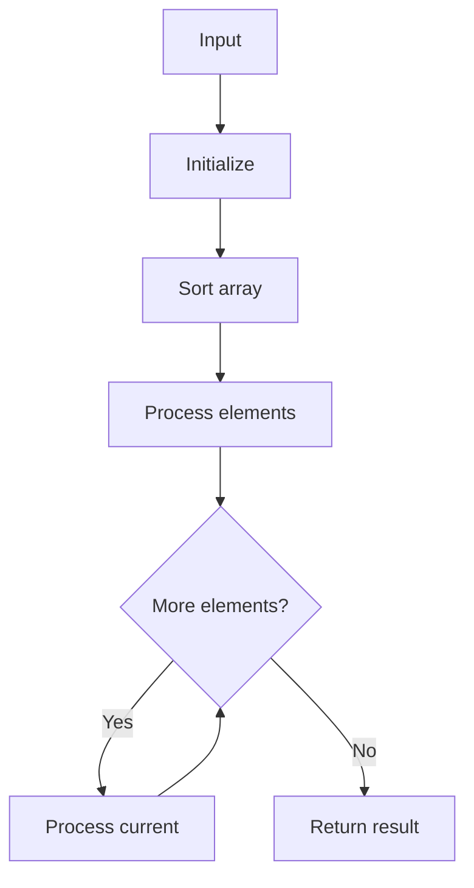

# LC 229 Majority Element II

## Problem

Return all elements appearing more than n/3 times.

## Approach

Frequency map; collect keys with count > n//3, sort.

## Complexity

O(n) time, O(n) space.



## Run Tests

```bash
python -m Hash_Map.LC_229.test
```
