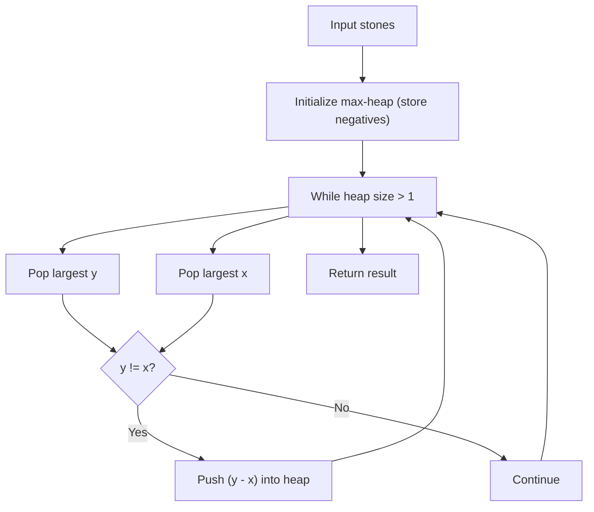

# LC 1046 - Last Stone Weight

Given an integer array `stones` where `stones[i]` is the weight of the `i`th stone, we repeatedly choose the two heaviest stones and smash them together. If the two stones have equal weight, both are destroyed. If they have different weights, the heavier stone is destroyed and the remaining weight (difference) is added back to the collection. This process continues until at most one stone remains.

Return the weight of the last remaining stone, or 0 if there are no stones left.

## Example 1
```
Input: stones = [2,7,4,1,8,1]
Output: 1
```

## Example 2
```
Input: stones = [1,3,7,1]
Output: 0
```

## Example 3
```
Input: stones = [10,4,2,10]
Output: 2
```

## Constraints
- `1 <= stones.length <= 30`
- `1 <= stones[i] <= 1000`

