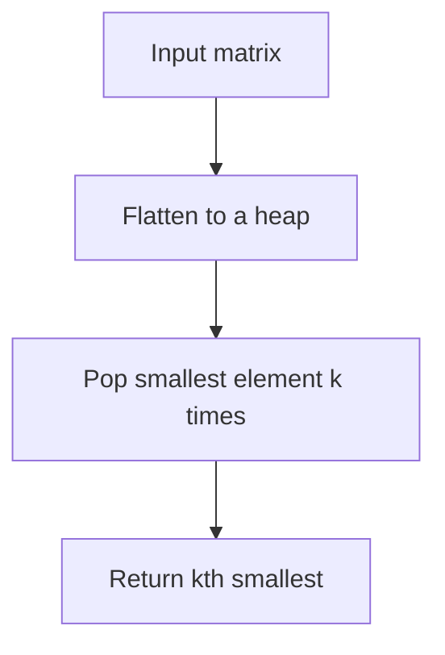

# LC 378 - Kth Smallest Element in a Sorted Matrix

Given an `n x n` matrix where each row and each column is sorted in ascending order, return the kth smallest element in the matrix.

## Example 1
```
Input: matrix = [[1,5,9],[10,11,13],[12,13,15]], k = 8
Output: 13
```

## Example 2
```
Input: matrix = [[-5]], k = 1
Output: -5
```

## Constraints
- `1 <= n <= 300`
- `-10^9 <= matrix[i][j] <= 10^9`
- `1 <= k <= n * n`

