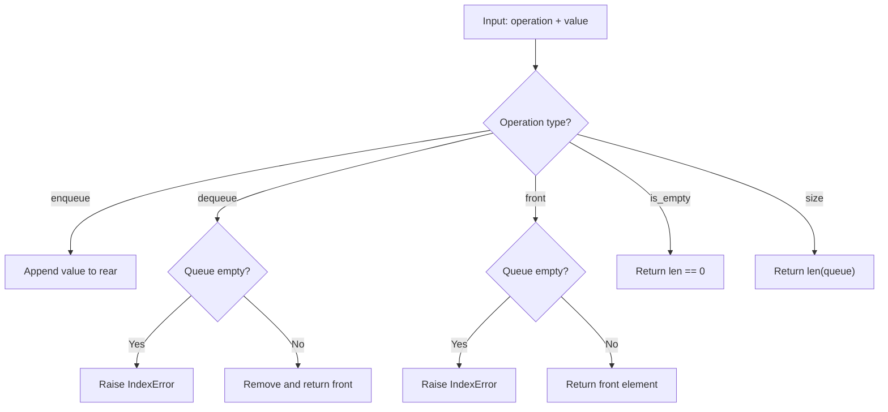

# Queue Basics

## Problem

Implement a **Queue** (FIFO - First In, First Out) data structure with the following operations:

- `enqueue(value)` - Add an element to the rear of the queue
- `dequeue()` - Remove and return the element from the front
- `front()` - Return the front element without removing it
- `is_empty()` - Check if the queue is empty
- `size()` - Return the number of elements

---

## Examples

### Example 1

```
enqueue(10) -> enqueue(20) -> enqueue(30)
Queue: [10, 20, 30]
front() -> 10
dequeue() -> 10
Queue: [20, 30]
```

---

## Approach: List-Based Queue

### Key Insight

A queue can be implemented using a Python list. `enqueue` appends to the end (O(1) amortized), `dequeue` removes from the front using `pop(0)` (O(n) due to shifting).

### Complexity Analysis

| Operation | Time | Space |
|-----------|------|-------|
| `enqueue` | O(1) amortized | O(1) |
| `dequeue` | O(n) | O(1) |
| `front` | O(1) | O(1) |
| `is_empty` | O(1) | O(1) |
| `size` | O(1) | O(1) |

---

## Flowchart



---

## File Structure

```
Queue/
└── Basics/
    ├── basics.py    # Queue implementation
    ├── test.py      # Unit tests
    └── README.md    # Documentation
```