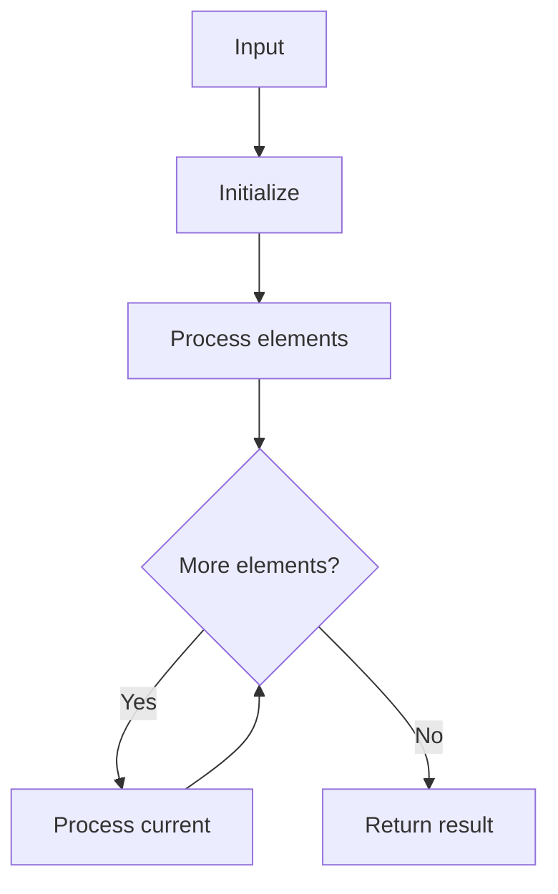

# GFG Sorted and Rotated Minimum

## Problem

Find minimum in sorted and rotated array.

## Approach

Binary search comparing mid with high.

## Complexity

O(log n) time, O(1) space.



## Run Tests

```bash
python -m Searching.GFG_Sorted_and_Rotated_Minimum.test
```
