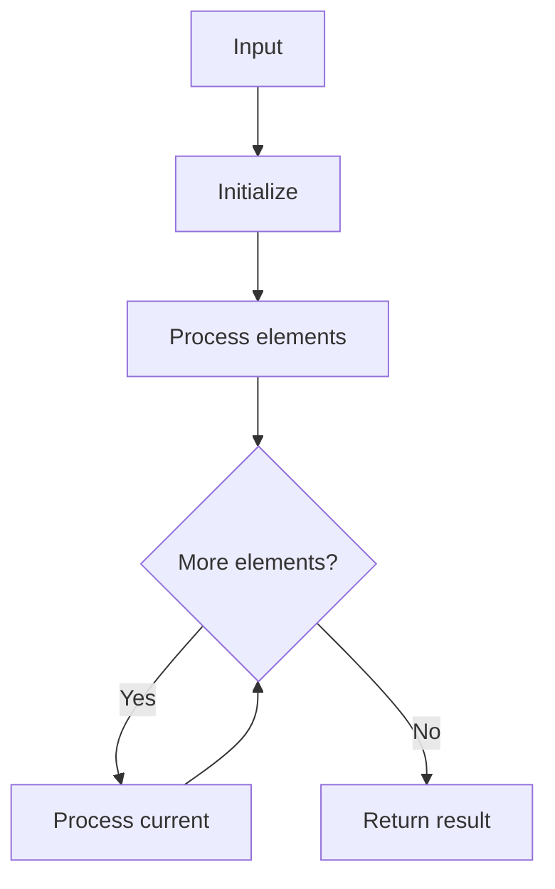

# LC 153 Find Minimum in Rotated Sorted Array

## Problem

Find minimum in rotated sorted array (distinct values).

## Approach

Binary search comparing mid with right.

## Complexity

O(log n) time, O(1) space.



## Run Tests

```bash
python -m Searching.LC_153.test
```
