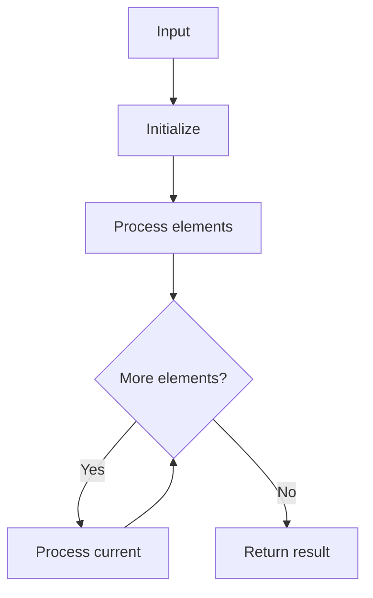

# LC 33 Search in Rotated Sorted Array

## Problem

Search target in rotated sorted array (distinct values).

## Approach

Binary search using sorted half.

## Complexity

O(log n) time, O(1) space.



## Run Tests

```bash
python -m Searching.LC_33.test
```
