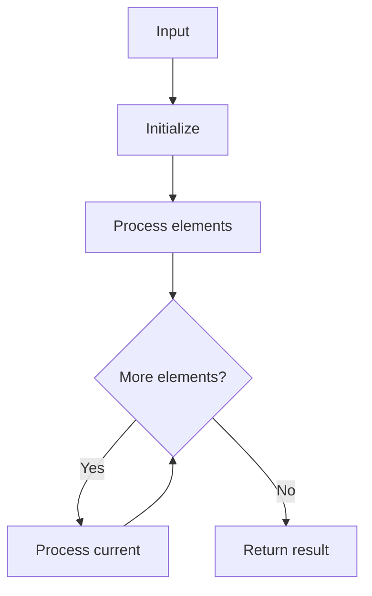

# LC 81 Search in Rotated Sorted Array II

## Problem

Search target in rotated sorted array with duplicates.

## Approach

Binary search with duplicate handling.

## Complexity

O(n) worst, O(log n) average; O(1) space.



## Run Tests

```bash
python -m Searching.LC_81.test
```
