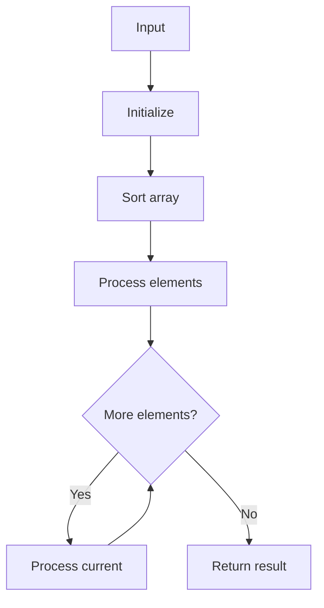

# GFG Sort 0s, 1s and 2s

## Problem

Sort an array containing only 0, 1, 2 in one pass (Dutch National Flag).

## Approach

Three pointers: low, mid, high. Partition 0s left, 2s right, 1s middle.

## Complexity

O(n) time, O(1) space.



## Run Tests

```bash
python -m Sorting.GFG_Sort_0s_1s_2s.test
```
