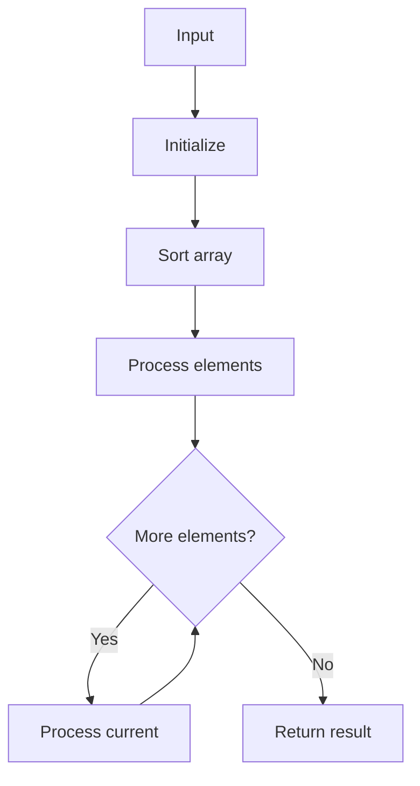

# LC 75 Sort Colors

## Problem

Sort array of 0s, 1s, 2s in-place (Dutch National Flag).

## Approach

Three pointers low, mid, high.

## Complexity

O(n) time, O(1) space.



## Run Tests

```bash
python -m Sorting.LC_75.test
```
