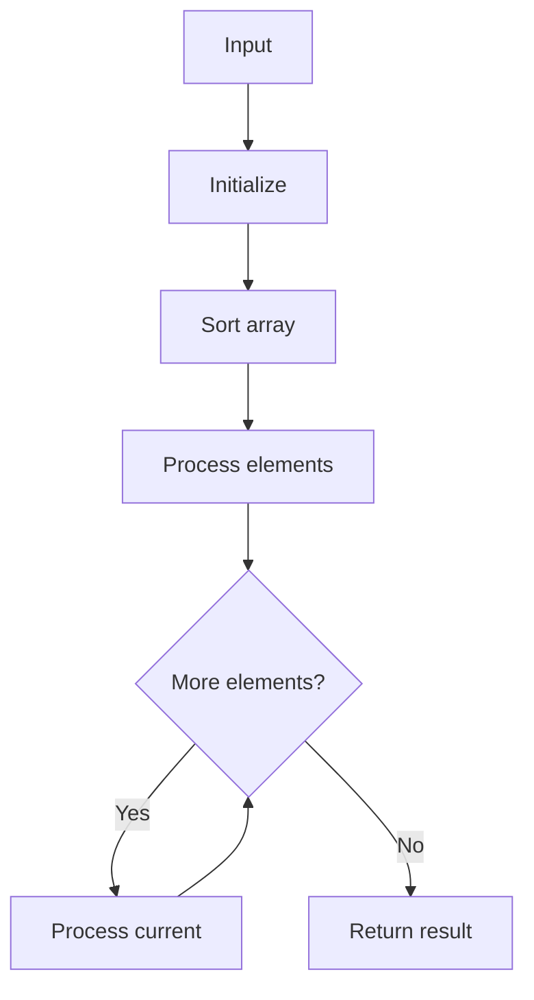

# LC 910 Smallest Range II

## Problem

Given array and k, add/subtract k to each element to minimize (max - min).

## Approach

Sort; try split point; left +k, right -k.

## Complexity

O(n log n) time, O(1) space.



## Run Tests

```bash
python -m Sorting.LC_910.test
```
