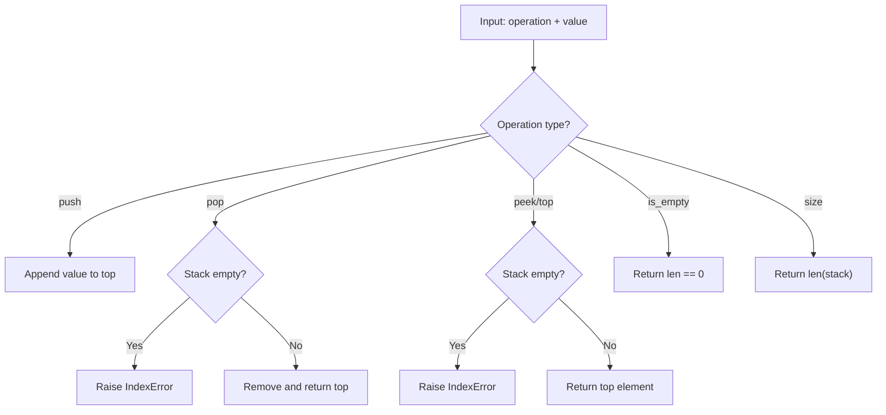

# Stack Basics

## Problem

Implement a **Stack** (LIFO - Last In, First Out) data structure with the following operations:

- `push(value)` - Add an element to the top of the stack
- `pop()` - Remove and return the element from the top
- `peek()` / `top()` - Return the top element without removing it
- `is_empty()` - Check if the stack is empty
- `size()` - Return the number of elements

---

## Examples

### Example 1

```
push(10) -> push(20) -> push(30)
Stack: [10, 20, 30] (30 on top)
peek() -> 30
pop() -> 30
Stack: [10, 20]
```

---

## Approach: List-Based Stack

### Key Insight

A stack can be implemented using a Python list. `push` appends to the end (O(1) amortized), `pop` removes from the end (O(1)), and `peek` returns the last element (O(1)).

### Complexity Analysis

| Operation | Time | Space |
|-----------|------|-------|
| `push` | O(1) amortized | O(1) |
| `pop` | O(1) | O(1) |
| `peek` | O(1) | O(1) |
| `is_empty` | O(1) | O(1) |
| `size` | O(1) | O(1) |

---

## Flowchart



---

## File Structure

```
Stack/
└── Basics/
    ├── basics.py    # Stack implementation
    ├── test.py      # Unit tests
    └── README.md    # Documentation
```