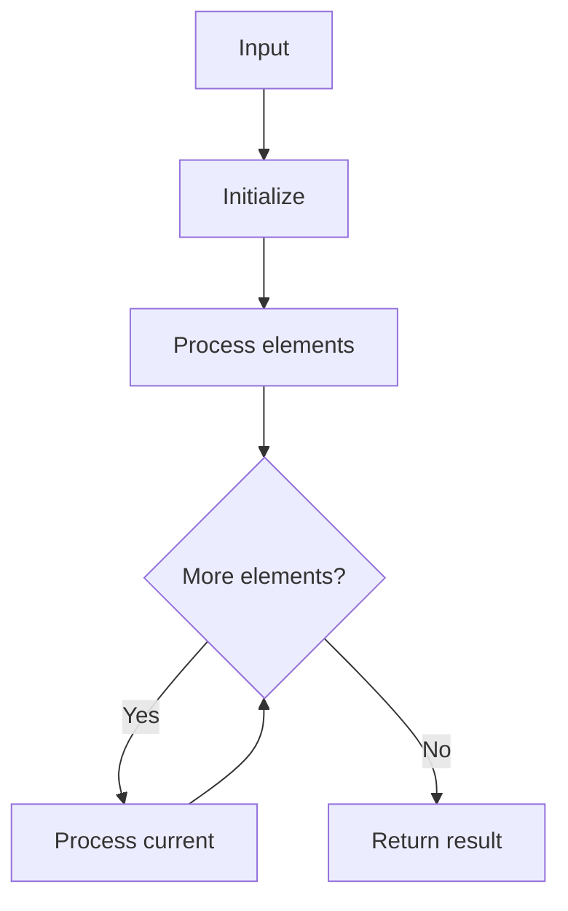

# LC 496 Next Greater Element I

## Problem

For each element in `nums1`, find the next greater element in `nums2` (to its right). Return -1 if none.

## Approach

Monotonic stack over nums2 building a next-greater map.

## Complexity

O(n + m) time, O(n) space.



## Run Tests

```bash
python -m Stack.LC_496.test
```
